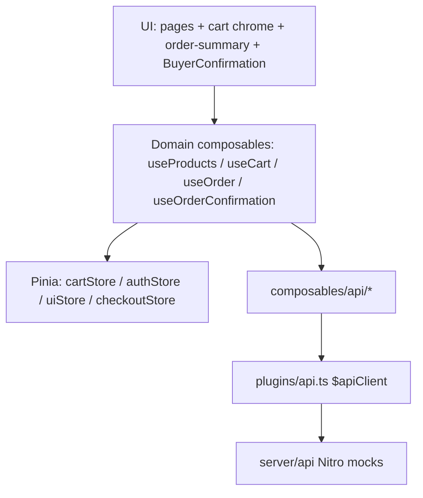
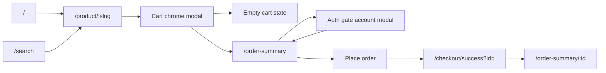
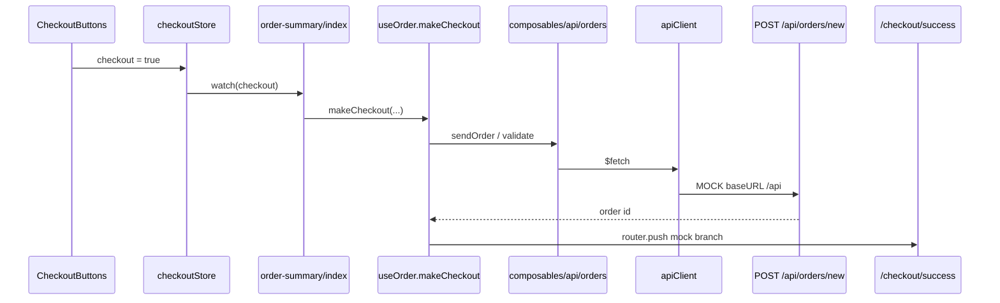
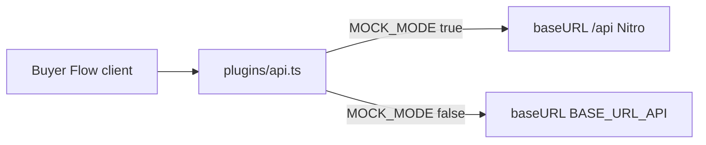

# Buyer Flow — as-built architecture

Visual map of the **current** Buyer Flow (discovery → cart → auth → Order Confirmation). Companion to [`buyer-flow-design-contract.md`](./buyer-flow-design-contract.md). Diagrams and tables first; captions only.

---

## 1. Layer stack

Contracted path: UI does not call API helpers directly; domain composables own orchestration.

---

## 2. Route map

`/cart` always redirects to `/order-summary`. Checkout shell (`/checkout/*`) uses `middleware/auth.ts`.

---

## 3. Place-order sequence (mock)

Live mode diverges after `sendOrder` (Stripe / session routes instead of success push).

---

## 4. Stage module map

| Stage                 | Responsibility                       | Key files                                                                                                                                                     | Talks to                                            |
| --------------------- | ------------------------------------ | ------------------------------------------------------------------------------------------------------------------------------------------------------------- | --------------------------------------------------- |
| Discovery             | Featured, search, PDP load           | `composables/useProducts.ts`, `pages/index.vue`, `pages/search.vue`, `pages/product/[slug].vue`, `composables/api/products.ts`                                | `$apiClient` → `server/api/products/*`              |
| Cart                  | Add/update/remove, badge, modal      | `composables/useCart.ts`, `store/cartStore.ts`, `helpers/cart-pricing.ts`, `components/layout/favorites-cart-modal/*`, `components/layout/header/MainRow.vue` | `composables/api/cart.ts` → `server/api/cart.*`     |
| Auth gate             | Open account modal; protect checkout | `store/uiStore.ts`, `composables/useCart.ts`, `middleware/auth.ts`, `components/layout/account-modal/*`                                                       | `composables/api/auth.ts`, `authStore`              |
| Order summary / place | Totals, payment UI, place order      | `pages/order-summary/index.vue`, `composables/useOrder.ts`, `store/checkoutStore.ts`, `components/order-summary/*`                                            | `composables/api/orders.ts` → `server/api/orders/*` |
| Confirmation          | Order facts after place              | `pages/order-summary/[id].vue`, `composables/useOrderConfirmation.ts`, `helpers/order-money.ts`, `components/order-confirm/BuyerConfirmation.vue`             | `composables/api/orders.ts` GET order               |

---

## 5. Mock Integration Boundary

| Behavior                        | File                                                                      | Mock vs live                                        |
| ------------------------------- | ------------------------------------------------------------------------- | --------------------------------------------------- |
| API base URL                    | `plugins/api.ts`                                                          | `/api` vs `BASE_URL_API`                            |
| Guest cart GET                  | `composables/api/cart.ts`                                                 | Allowed in mock; blocked without token live         |
| Featured products fetch         | `composables/api/products.ts`                                             | `useRequestFetch('/api/products/featured')` in mock |
| Skip auth prompt on add         | `composables/useCart.ts`                                                  | Mock skips; live may open account modal             |
| Post-order routing              | `composables/useOrder.ts`                                                 | Push `/checkout/success?id=` vs Stripe/session      |
| Credit / mock checkout defaults | `pages/order-summary/index.vue`                                           | Mock-only defaults when signed in                   |
| Auth token parse                | `middleware/auth.ts`                                                      | Mock token helper                                   |
| Payment method / cards UI       | `components/order-summary/PaymentMethodSection.vue`, `OrderStockType.vue` | Hide live Stripe affordances in mock                |

---

## 6. Observations — issues / improvement candidates

Candidates only (not a commitment to implement).

| ID  | Symptom                                                                                                   | Where                                                         | Hits shall | Related issue   | Candidate direction                                                   |
| --- | --------------------------------------------------------------------------------------------------------- | ------------------------------------------------------------- | ---------- | --------------- | --------------------------------------------------------------------- |
| O-1 | Order-summary still coordinates via Emitter (`order-type`, `payment-type`, `note`, `delete-product-item`) | `pages/order-summary/index.vue`, `components/order-summary/*` | R-4, R-11  | #395 follow-ons | Prefer Pinia/composable state like cart chrome                        |
| O-2 | Search filters still Emitter-driven                                                                       | `pages/search.vue`, search filter components                  | R-2, UC-2  | —               | Move filter/keyword state to composable/store                         |
| O-3 | `MOCK_MODE` branches place-order routing inside application orchestration                                 | `composables/useOrder.ts`                                     | R-1, R-8   | #427            | Outcome-based result type; adapter behind seam                        |
| O-4 | Payment / card UI sprinkles `MOCK_MODE` checks                                                            | `PaymentMethodSection.vue`, `OrderStockType.vue`              | R-1, R-10  | #433            | Single mock/live decision path for payment visibility                 |
| O-5 | Order summary hand-rolls VAT (`0.19`) instead of Order Money                                              | `pages/order-summary/index.vue` `syncOrderTotals`             | R-8        | #426            | Route totals through `helpers/order-money.ts`                         |
| O-6 | Place-order triggered by boolean `checkoutStore.checkout` watch                                           | `store/checkoutStore.ts`, `pages/order-summary/index.vue`     | R-11       | —               | Direct `makeCheckout` call (or explicit command) from CheckoutButtons |
| O-7 | Signup / account mutations may still bypass application seam on some surfaces                             | account / signup entry points                                 | R-5, R-6   | #431            | UI → domain composable → API helpers                                  |
| O-8 | Account-modal open path may still have event-bus residue off cart                                         | auth-gated continue checkout                                  | R-5, UC-3  | #432            | Explicit Pinia/composable open only                                   |

---

## 7. Related

- [`docs/buyer-flow-design-contract.md`](./buyer-flow-design-contract.md) — problem, scope, use cases, shalls
- [`CONTEXT.md`](../CONTEXT.md) — Buyer Flow glossary
- [`docs/agents/verification.md`](./agents/verification.md) — verification ladder
