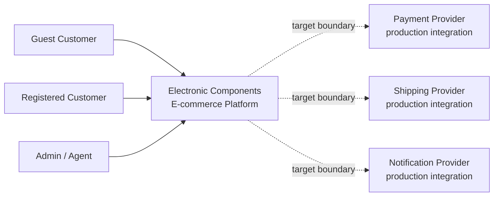
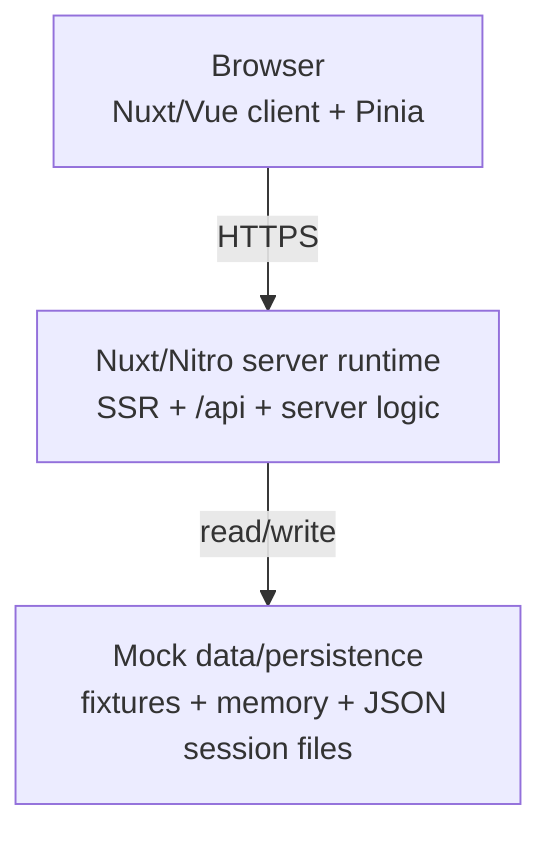

# Components Marketplace — System Design Review and Production-Quality Target

**Status:** living architecture document  
**Checkpoint:** 2026-08-24  
**Scope:** captures the system-design work completed so far for the existing Components Marketplace codebase.

This document intentionally separates three ideas that should not be conflated:

1. **Product intent** — a production-quality electronic-components e-commerce application used to demonstrate engineering capability.
2. **Deployment mode** — the current repository is a self-contained portfolio/demo environment.
3. **Integration mode** — external services may be mocked or sandboxed, while the application boundaries and business rules should be designed so real integrations can replace them without a fundamental redesign.

This document does **not** silently expand the current Portfolio Demo delivery scope defined in `CONTEXT.md` and `docs/buyer-flow-design-contract.md`. It records the architectural target and production-readiness reasoning that should guide future work.

---

## 0. Review method

For an existing application, the architecture workflow used here is:

```text
UNDERSTAND
  ↓
MAP
  ↓
TRACE
  ↓
EVALUATE
  ↓
DESIGN
  ↓
MIGRATE
```

Expanded:

1. Business purpose and functional requirements
2. Quality attributes, constraints, and target production envelope
3. System Context
4. Container Architecture
5. Critical Runtime Flows
6. Domain/component boundaries and ownership
7. Data ownership
8. Architectural risks and technical debt
9. Target architecture
10. Current → target gap analysis
11. Migration/refactoring plan
12. ADRs for significant decisions

For each area, distinguish:

```text
What SHOULD the architecture do?
        ↓
What does the application CURRENTLY do?
        ↓
Is the current design appropriate?
        ↓
What is the smallest useful improvement?
```

---

# 1. Product purpose and functional requirements

## 1.1 Product intent

Components Marketplace is treated as a **production-quality e-commerce application delivered through a portfolio/demo environment**.

The goal is not to pretend the demo has production traffic or live customers. The goal is to demonstrate production-minded engineering in areas such as:

- clear system and domain boundaries
- server-side authority over business-critical data
- security and authorization boundaries
- resilient checkout behavior
- idempotency and failure recovery
- maintainable application structure
- SSR/hydration correctness
- explicit loading/error/empty states
- testability and regression protection
- replaceable external integrations

A useful summary is:

> The demo environment may use mock implementations, but production-relevant business invariants should live behind boundaries that can support real implementations without a major architectural rewrite.

## 1.2 Actors

### Guest customer

Can:

- browse products
- search and filter products
- view product details
- add items to cart
- update/remove cart items
- begin or complete guest checkout where supported
- register or sign in

### Registered customer

Can do everything available to a guest plus:

- view order history
- view order details/status
- manage profile and addresses
- manage billing information within allowed boundaries
- reorder previous purchases

### Agent / Admin

Can perform operational work such as:

- view orders
- update allowed order states
- view customer information within authorization limits
- create/edit/deactivate products
- view and adjust inventory
- view inventory history/analytics
- create/deactivate customers where appropriate
- perform allowed operational actions such as cancellation/refund/internal notes

For historical business records, prefer **cancel/deactivate/refund** over destructive deletion unless the domain explicitly permits deletion.

## 1.3 Critical business flows

Customer-side:

```text
Discover/search product
→ Product detail
→ Cart
→ Checkout
→ Payment
→ Order confirmation
→ Order history/status
```

Admin/agent-side:

```text
Authenticate
→ Inspect products/inventory/orders/customers
→ Perform authorized operational action
→ Persist auditable state change
```

---

# 2. Quality attributes, constraints, and production envelope

## 2.1 Target production envelope

These are **design assumptions**, not claims about current traffic:

- approximately 5,000 products initially
- hundreds to low thousands of users/day
- tens of concurrent users
- tens to low hundreds of orders/day
- primarily EU-oriented operation

The purpose of the envelope is to prevent both under-design and unnecessary over-engineering.

For this envelope, the default architectural direction is:

```text
Modular monolith        ✅
Relational database      ✅
Normal DB transactions   ✅
Server-side invariants   ✅

Microservices            ❌ not currently justified
Kafka/event platform     ❌ not currently justified
Kubernetes               ❌ not currently justified
Multi-region active/active ❌ not currently justified
```

## 2.2 Correctness requirements

Business-critical values that require authoritative validation include:

- inventory at reservation/purchase time
- checkout/order price
- discounts
- shipping cost used for order creation
- payment state
- order state
- customer/cart ownership

Values that may tolerate temporary staleness include:

- product images
- detailed marketing descriptions
- similar/recommended products

A displayed product price may be stale briefly, but the backend must revalidate the authoritative price before accepting an order.

## 2.3 Operations that must not duplicate

The architecture must prevent or safely recover from:

- charging the same checkout twice
- creating duplicate orders for the same checkout attempt
- consuming the same last unit concurrently

These are different classes of problem:

- **duplicate checkout/payment** → idempotency
- **two customers buying the last unit** → concurrency control / atomic reservation

## 2.4 Reliability

Critical flows should remain recoverable when a failure occurs halfway through.

Important principle:

> HTTP success/failure is not the same as business success/failure.

A timeout may occur after an external provider or database operation has already succeeded. The application must not blindly infer business state from network state.

## 2.5 Performance

Highly latency-sensitive interactions:

- search/product discovery
- product navigation
- cart add/remove/update feedback

Operations that may tolerate more latency with good UX feedback:

- checkout
- shipping calculation
- large order-detail views
- heavier admin operations

Given the production envelope, product reads will greatly outnumber order writes.

## 2.6 Security

The target architecture should enforce:

- customers can access only their own private account/order data
- admin/agent actions require explicit authorization
- client-provided identity is not trusted as authorization truth
- client-provided price/total/payment state is not trusted
- sensitive payment data should not be handled directly when a provider token/reference can be used
- important privileged mutations should be auditable

## 2.7 Frontend quality

- SSR and client hydration must remain consistent
- server state and UI state should not be confused
- loading/error/empty states should be explicit
- optimistic updates need rollback/reconciliation
- client caches are representations, not business authority

## 2.8 Operability

Production-minded behavior includes:

- meaningful errors
- structured logging
- traceable checkout/payment failures
- automated regression checks
- CI verification
- recovery/reconciliation mechanisms for critical external operations

---

# 3. Domain model and invariants established so far

## 3.1 Core entities

Working domain model:

```text
Customer
├── UserAccount?
├── Cart
│   └── CartItem
│       └── Product
└── Order
    ├── OrderItem
    │   └── Product
    ├── Payment
    ├── ShippingAddress
    └── BillingAddress

Product
├── Category
└── Inventory

StaffUser
└── Role
    ├── Agent
    └── Admin
```

### Customer vs UserAccount

Guest checkout means buyer identity and login identity should not automatically be treated as the same concept.

- `Customer` = buyer/business identity
- `UserAccount` = authentication/login identity

A customer may exist without a registered account.

### CartItem / OrderItem

Cart and Order should not point directly to Products as the whole relationship because the relationship carries domain data such as:

- quantity
- price snapshot
- discount
- backorder quantity

`OrderItem` should preserve historical order facts even when the current Product later changes.

### Payment

Payment should be modeled as durable transaction/state information, not merely as a verb/process.

### Inventory

Useful conceptual fields:

```text
onHand
reserved
available = onHand - reserved
```

Backorder policy should be explicit rather than relying on accidental negative stock.

## 3.2 Core invariants

1. Cart must contain at least one valid purchasable item before checkout can complete.
2. Required customer/shipping/billing information must exist before checkout completes.
3. An order must not become paid/confirmed unless the payment state permits it.
4. Inventory availability must not be violated by concurrent purchases.
5. Once fulfillment has passed the allowed modification point, purchased items/quantities/prices/destination cannot be arbitrarily changed.
6. Historical `OrderItem` price does not change when `Product.price` changes.
7. A customer can access only their own private orders/account data.
8. Sensitive/privileged changes require sufficient permission and should be auditable.
9. Client-computed totals are never authoritative business truth.

## 3.3 Order and payment state machines

Working Order states:

```text
PENDING_PAYMENT → PAID | CANCELLED | EXPIRED
PAID            → PROCESSING | CANCELLED
PROCESSING      → SHIPPED | ON_HOLD | CANCELLED
ON_HOLD         → PROCESSING | CANCELLED
SHIPPED         → DELIVERED
```

Actual cancellation rules depend on fulfillment progress.

The first preparation slice uses a small independent local Payment state machine:

```text
PENDING
PAID
FAILED
```

Later provider reconciliation may add richer semantic states and refund lifecycle. Those states are intentionally deferred. The current local model still allows combinations such as:

```text
Order = CANCELLED
Payment = REFUNDED
```

Do not overload one status field with multiple independent lifecycle dimensions.

---

# 4. Business operations and API-contract principles

## 4.1 Customer operations

Products:

- search products
- get product details
- favorite/unfavorite
- request product information

Cart:

- get current cart
- add item
- remove item
- update quantity
- clear cart

Checkout:

- start checkout
- validate checkout
- submit/place order
- retrieve checkout/order result

Orders:

- list own orders
- get order details
- cancel where allowed
- reorder previous order
- perform specific allowed changes rather than a generic "edit order"

## 4.2 Admin/agent operations

Products:

- create
- edit
- deactivate
- view

Inventory:

- view status
- view analytics/history
- adjust inventory
- record incoming stock

Orders:

- list/detail
- explicit state transitions
- cancel where permitted
- refund where permitted
- internal notes
- update only fields allowed by current order state

Customers:

- list/detail
- update allowed non-sensitive information
- create
- deactivate

## 4.3 API boundary principle

**Client sends intent. Server establishes business truth.**

Preferred checkout intent shape is conceptually closer to:

```ts
type CheckoutRequest = {
  cartId: string;
  shippingAddress: AddressInput;
  billingAddress?: AddressInput;
  deliveryMethodId: string;
  paymentMethodId: string;
  note?: string;
  idempotencyKey: string;
};
```

The request should not treat these as authoritative client inputs:

- product price
- order total
- stock availability
- product name snapshot
- discount amount
- authenticated customer ID
- payment success state

Authenticated customer identity should be derived from the server-side session/token. Guest checkout should provide the contact data required for the order.

---

# 5. Frontend/server ownership principles

Current working classification:

| State/data                        | Ownership                                        |
| --------------------------------- | ------------------------------------------------ |
| Product search/filter UI state    | frontend/navigation owned                        |
| Product price                     | backend authoritative                            |
| Cart UI state                     | frontend owned                                   |
| Authoritative cart                | shared representation, backend authoritative     |
| Inventory availability            | backend authoritative                            |
| Checkout total                    | backend authoritative                            |
| Order status                      | backend authoritative                            |
| Modal open/closed                 | frontend owned                                   |
| Logged-in customer representation | shared, backend authoritative for identity/authz |

Useful frontend state categories:

```text
UI STATE
- modal open
- selected tab
- dropdown open

NAVIGATION STATE
- search
- filters
- sort
- pagination

SERVER/DOMAIN STATE
- products
- cart
- customer
- inventory
- orders

DERIVED STATE
- cart item count
- display subtotal
- isCheckoutAllowed
```

Avoid treating all four categories as a single generic Pinia "source of truth".

---

# 6. System Context — current working view

## 6.1 System name and boundary

Use a product-oriented name rather than the historical repository name in architecture diagrams:

**Electronic Components E-commerce Platform** / **Components Marketplace**.

At System Context level, the system boundary is the complete e-commerce application delivered by this repository. Internal Nuxt, Pinia, Nitro, composables, and mock data are intentionally hidden at this level.

## 6.2 People

- Guest Customer
- Registered Customer
- Admin / Agent

## 6.3 Current external systems

In recommended mock mode, no external runtime system is required for the core Buyer Flow. Nitro mock APIs and mock data are inside the platform boundary.

## 6.4 Expected production integrations

Likely replaceable external boundaries include:

- payment provider
- shipping/delivery provider
- email/notification provider

These are target integrations, not claims that the current mock flow calls them.

## 6.5 Context diagram



---

# 7. Container Architecture — current and target direction

## 7.1 Current runtime containers

### Browser / Nuxt client

Responsibilities:

- Vue UI
- routing/navigation
- client-side interaction
- Pinia state
- forms
- optimistic UI
- hydration of SSR output

### Nuxt/Nitro server runtime

Responsibilities:

- SSR
- HTTP API endpoints
- mock auth/cart/order/product behavior
- server-side business/data normalization currently implemented in mocks
- server-side persistence access

### Mock data/persistence

Current forms include:

- static/in-code fixture data such as products/users/dashboard data
- in-memory runtime state
- filesystem-backed mock session/cart persistence under `.data/mock-sessions`

## 7.2 Current simplified container diagram



## 7.3 Mock/live API seam

`plugins/api.ts` currently provides the important integration seam:

```text
MOCK_MODE=true
$apiClient → /api → bundled Nitro mock backend

MOCK_MODE=false
$apiClient → BASE_URL_API → external backend
```

## 7.4 Architectural decision: keep a modular monolith

For the target production envelope, keep:

```text
Nuxt + Nitro + real database
```

rather than splitting into a separate Node backend solely because traffic might grow.

A backend split should be driven by concrete architectural forces such as:

- multiple independent clients need the backend
- frontend/backend require independent deployment lifecycles
- separate teams own the domains
- backend workloads scale materially differently
- substantial background/long-running processing appears
- organizational/domain boundaries justify a service boundary

Traffic alone is not sufficient justification.

The likely production evolution is therefore:

```text
CURRENT
Browser
  ↓
Nuxt/Nitro
  ↓
Mock/static/filesystem persistence

TARGET DIRECTION
Browser
  ↓
Nuxt/Nitro modular monolith
  ↓
Relational database (for example PostgreSQL)

+ replaceable external providers
```

A real relational database is higher priority than creating a second Node application because it supplies the capabilities currently missing for production semantics:

- transactions
- durability
- constraints
- relationships
- indexes
- atomic updates
- concurrency control

---

# 8. Critical Runtime Flow #1 — Checkout

Checkout was chosen first because it crosses most important domains:

- customer/session
- cart
- products/pricing
- shipping
- inventory
- payment
- order
- failure recovery

## 8.1 Current as-built checkout flow

Current repository flow is approximately:

```text
1. User triggers checkout
        ↓
2. order-summary / checkout UI triggers checkout action
        ↓
3. useOrder.makeCheckout()
   - gathers cart/customer/address/payment data
   - runs client-side completeness checks
   - validates addresses through API
   - builds OrderRequest
        ↓
4. composables/api/orders.ts
   - transport wrapper
   - POST /orders/new
        ↓
5. plugins/api.ts $apiClient
   - /api in MOCK_MODE
        ↓
6. Nitro POST /api/orders/new
   - resolves authenticated or guest user
   - finds mock cart
   - creates runtime mock order
   - clears mock cart
   - simulates payment success
        ↓
7. response returns orderId/payment-style result
        ↓
8. useOrder resolves CheckoutOutcome
        ↓
9. frontend routes to success/session/redirect/failure
        ↓
10. cart refreshes
```

Important current implementation details:

- `composables/api/orders.ts` is primarily a transport layer, not the authoritative business validator.
- server-side mock cart normalization already looks up server-side mock products and recalculates line pricing.
- `/orders/new` can still prefer client-supplied order products.
- `createRuntimeOrder()` calculates fallback totals but accepts client-supplied `total` and `subtotal` when provided.
- runtime orders are stored in an in-memory `Map`, while mock cart sessions have stronger filesystem persistence.
- the mock handler immediately simulates payment success; it does not model real provider failure modes.

## 8.2 Checkout risks discovered

### RISK-01 — Client-controlled commercial data

Current checkout can carry client-calculated commercial values.

**Target invariant:** server determines authoritative product lines, current prices, discounts, shipping, stock, subtotal, and total from server-side state.

### RISK-02 — Inventory race

Two checkouts may attempt to reserve the last unit concurrently.

**Target invariant:** inventory availability is checked and reserved atomically.

A server timestamp alone is not sufficient. The check and mutation must be one atomic database operation or protected by an appropriate transaction/locking strategy.

Conceptual SQL:

```sql
UPDATE inventory
SET reserved = reserved + :qty
WHERE product_id = :productId
  AND on_hand - reserved >= :qty;
```

Only a successful affected-row result owns the reservation.

Timestamps remain useful for reservation expiry:

```text
reservation
- orderId
- productId
- quantity
- createdAt
- expiresAt
```

### RISK-03 — Duplicate checkout/payment

A lost response can cause a user/client to retry a request that already succeeded.

Frontend button disabling is not sufficient. Checkout and payment need server-side idempotency.

### RISK-04 — Partial failure

Order, reservation, payment, and cart operations can complete only partially.

Examples:

```text
order created       ✅
inventory reserved  ✅
payment succeeded   ✅
local PAID update   ❌
```

or:

```text
order created       ✅
cart cleared        ✅
HTTP response       ❌
```

The system must retain enough durable state to recover rather than guessing.

### RISK-05 — Ambiguous client result

A timeout does not prove checkout failed.

The client should be able to retrieve authoritative checkout/order state after an ambiguous network failure.

---

# 9. Target production checkout sequence

## 9.1 Happy-path sequence

```text
1. User clicks Checkout
        ↓
2. Frontend sends checkout intent
        ↓
3. Server authenticates user / resolves guest session
        ↓
4. Server loads authoritative cart and verifies ownership
        ↓
5. Server reloads/revalidates:
   - products
   - current prices
   - quantities
   - stock
   - discounts
   - shipping
   - addresses
        ↓
6. Server calculates authoritative subtotal/total
        ↓
7. DB transaction:
   - claim checkout ownership
   - create PENDING_PAYMENT order
   - atomically create inventory reservation
   - create one local PENDING Payment
   - persist relational correlations
        ↓
8. Commit durable claim/order/reservation/payment IDs
        ↓
9. Continue at the provider boundary (outside the retryable transaction)
        ↓
10. Resolve provider result
        ↓
11. On success, short DB transaction:
    - Payment → PAID
    - Order → PAID
    - commit inventory reservation/sale
    - clear purchased cart items
        ↓
12. Return authoritative checkout result
        ↓
13. Frontend renders/routes based on business result
```

## 9.2 Why create the order before payment?

The first order is a durable **PENDING_PAYMENT** record, not a completed order.

That gives later operations a stable aggregate identifier:

```text
orderId = ord_123
```

Inventory reservation and the one logical Payment can reference the same Order and become recoverable.

## 9.3 Why reserve inventory before payment?

The system should not charge a customer when the requested stock can no longer be secured.

Cart add does not reserve stock because abandoned carts would freeze inventory unnecessarily.

Working reservation policy:

```text
Cart            → no reservation
Checkout start  → validate + reserve
Payment success → reservation becomes committed sale
Timeout/failure → release reservation according to policy
```

## 9.4 Why payment is outside the DB transaction

Do not hold a database transaction open while waiting on a remote provider.

Bad:

```text
BEGIN
reserve inventory
call payment provider
wait on network
COMMIT
```

Preferred:

```text
short DB transaction
→ commit durable claim + order + reservation + local Payment
→ external provider call
→ short finalization transaction
```

In mock mode, the existing post-commit local demo completion may continue
after preparation. It does not represent production provider finalization or
reconciliation. If the continuation request crashes before local `PAID`, the
durable claim remains `payment_pending`; replay resumes its persisted
`orderId`, `reservationId`, and `paymentId`. If local `PAID` is recorded but
inventory, order, or cart finalization fails, the claim becomes
`recovery_required` while retaining those same IDs.

## 9.5 Idempotency

Conceptual identifiers:

```text
orderId = ord_123
paymentId = pay_456
idempotencyKey = checkout_ord_123
```

Retries for the same logical checkout/payment should reuse the same idempotency identity.

## 9.6 Payment timeout / unknown state

If the payment call times out:

```text
DO NOT assume payment failed
DO NOT immediately create a second charge
```

Instead reconcile against the provider:

```text
provider says SUCCEEDED
→ finalize local payment/order

provider says FAILED
→ mark failed, release reservation according to policy, allow retry

provider says PENDING
→ keep local pending state and wait/reconcile

provider says NOT FOUND
→ safe retry using same idempotency identity
```

## 9.7 Webhook + reconciliation recovery

Critical external operations need:

```text
durable local state
+ idempotent handlers
+ provider webhook/callback handling
+ reconciliation
```

Example recovery path:

```text
Provider payment succeeded
→ server crashed before local PAID update
→ provider webhook later arrives
→ lookup providerReference
→ finalizePayment(orderId)
```

`finalizePayment()` must itself be idempotent so duplicate webhooks are harmless.

A periodic reconciliation process can find old inconsistent states such as:

```text
Order = PENDING_PAYMENT
Payment = PENDING
createdAt < threshold
```

and ask the provider for the authoritative payment state.

## 9.8 Authority by domain

When systems disagree, reconcile against the correct authority rather than guessing.

```text
Payment provider → authoritative about whether provider-side money movement succeeded
Order database   → authoritative about local order lifecycle
Inventory DB     → authoritative about sellable/reserved stock
Frontend         → presentation/interaction representation, not business authority
```

---

# 10. Current checkout vs production target

| Area                     | Current implementation                                                  | Production-quality target                     | Gap                                  |
| ------------------------ | ----------------------------------------------------------------------- | --------------------------------------------- | ------------------------------------ |
| Identity                 | server resolves mock auth/guest user                                    | server-authenticated identity                 | foundation exists                    |
| Cart                     | server-side mock cart + session persistence                             | durable authoritative cart                    | persistence replacement              |
| Cart pricing             | server mock cart recalculates against mock products                     | server authoritative                          | useful foundation                    |
| Checkout total           | client values may override fallback calculation                         | server-only calculation                       | high                                 |
| Products in order        | request products can be preferred                                       | reload authoritative cart lines               | high                                 |
| Order persistence        | PostgreSQL-backed checkout Order snapshot                               | durable relational persistence                | foundation exists                    |
| Initial order state      | durable PENDING_PAYMENT during preparation                              | durable PENDING_PAYMENT                       | foundation exists                    |
| Inventory reservation    | durable reservation during preparation                                  | atomic reservation                            | finalization policy deferred         |
| Payment                  | one local PENDING Payment; mock continuation can mark PAID after commit | provider abstraction after commit             | provider continuation/reconciliation |
| Idempotency              | durable claim, aliases, and cart-revision uniqueness                    | mandatory                                     | focused verification pending         |
| Partial failure recovery | claim can retain IDs and become recovery_required                       | explicit recoverable states                   | recovery workflow deferred           |
| Cart clearing            | revision-aware completion after local PAID                              | clear purchased items after committed success | provider finalization deferred       |
| Webhook/reconciliation   | unnecessary for deterministic mock                                      | required for real provider                    | future integration                   |
| Frontend outcome model   | `CheckoutOutcome` abstraction exists                                    | explicit business result model                | good direction                       |

The current mock checkout should not be described simply as "bad." It is optimized for a deterministic portfolio walkthrough. The production-readiness gap is that its current deterministic shortcuts do not yet model the invariants required by a real checkout.

---

# 11. Architectural decisions made so far

1. **Production-quality architecture, demo-safe deployment**  
   The portfolio/demo runtime can use mock providers, but business-critical architecture should demonstrate production-minded boundaries and correctness.

2. **Keep a modular monolith for the current target envelope**  
   Nuxt/Nitro remains an appropriate application/server boundary. Do not split a separate Node backend without concrete drivers.

3. **Prefer a real relational database before a backend split**  
   Transactions, constraints, durability, relationships, and concurrency are more valuable to the current target than creating another deployable service.

4. **Server is authoritative for business truth**  
   Price, stock, checkout totals, order state, payment state, and authorization decisions cannot be trusted to the browser.

5. **Client sends intent**  
   Checkout payloads should identify the cart, chosen options, addresses, and provider references; the server reconstructs/revalidates authoritative commercial values.

6. **Inventory reservation must be atomic**  
   Timestamps can support expiry but do not solve concurrency races.

7. **Checkout/payment must be idempotent**  
   Network retry must not create duplicate orders or charges.

8. **Critical external operations need recovery**  
   Durable state + idempotent handlers + provider reconciliation/webhooks are required for payment correctness.

9. **Clear cart only after purchase is safely committed**  
   Failed/ambiguous checkout should not destroy the customer's recovery context.

---

# 12. Next system-design step

Completed so far:

```text
1. Product purpose / functional requirements     ✅
2. Quality attributes / target envelope           ✅
3. System Context                                 ✅
4. Container Architecture                         ✅
5. Critical Runtime Flow — Checkout               ✅
```

Next:

```text
6. Domain/component boundaries and ownership
```

The next review should use what checkout exposed to decide explicit ownership for modules such as:

- Product
- Cart
- Checkout
- Inventory
- Order
- Payment
- Customer/Auth
- Admin operations

Then continue with:

```text
7. Data ownership
8. Risk prioritization
9. Target architecture
10. Current → target gap analysis
11. Migration plan
12. ADRs
```

---

# 13. Relevant current repository evidence

Useful files for continuing this review:

- `CONTEXT.md` — current Portfolio Demo terminology and integration boundary
- `docs/buyer-flow-design-contract.md` — current Buyer Flow requirements
- `docs/buyer-flow-architecture.md` — current as-built Buyer Flow layers/sequences
- `plugins/api.ts` — mock/live API boundary
- `composables/useCart.ts` — client cart orchestration and optimistic update behavior
- `store/cartStore.ts` — cart representation/persistence behavior
- `composables/useOrder.ts` — current checkout orchestration
- `composables/api/orders.ts` — order API transport functions
- `server/api/orders/new.post.ts` — current mock order creation endpoint
- `server/utils/mockCart.ts` — server mock cart, pricing normalization, session persistence
- `server/utils/mockRuntimeOrders.ts` — runtime order creation/persistence model
- `server/utils/mockSessionStore.ts` — filesystem-backed mock session persistence
- `DECISIONS.md` — durable project decisions

This document should be updated as later system-design steps change or supersede these conclusions.
