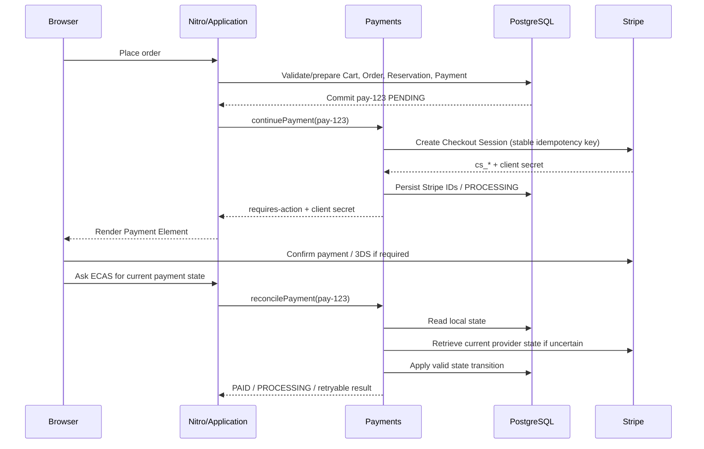
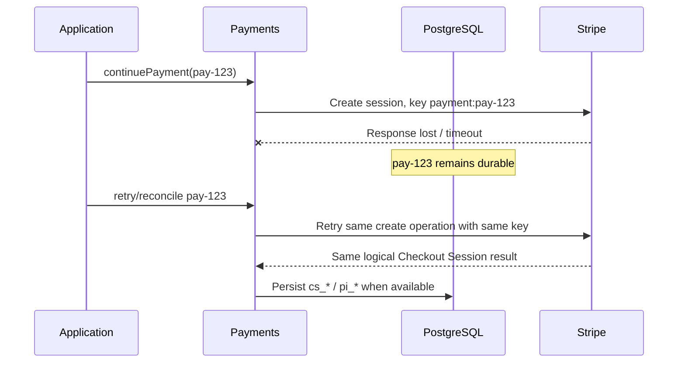

# System Design #8 — Stripe Payment Provider and Recovery Contract

Status: Accepted for implementation review  
Date: 2026-09-20  
Tracks: #121

## Purpose

System-design steps #6 and #7 established domain ownership, dependency direction,
durable checkout identity, commit-before-provider behavior, and provider-neutral
Payments seams. This document records the Stripe-specific decisions needed to
replace the current mock continuation without reopening those accepted
architecture decisions.

This is an ADR/design contract, not a live Stripe implementation.

The design intentionally stays proportional to agent-Commerce:

- one Nuxt/Nitro modular monolith;
- PostgreSQL as the durable checkout/payment store;
- Stripe as an external payment provider;
- no queues, brokers, microservices, distributed saga framework, or provider-attempt
  table until a demonstrated recovery requirement justifies them.

---

## 1. Context and current implementation seam

Current `server/domain/payments/index.ts` already provides:

- one durable local Payment per prepared Order;
- `preparePayment()` before provider continuation;
- `getPaymentPreparation()`;
- `continuePayment()` outside the retryable checkout transaction;
- local `PENDING / PAID / FAILED` state;
- a provider-neutral `PaymentNextAction` seam.

Current `placeOrder` persists the checkout claim, immutable Order, inventory
reservation, and local Payment before calling provider continuation.

That commit-before-provider boundary remains accepted.

The current gaps are provider-specific:

- `continuePayment()` still simulates success;
- `provider_reference` is ambiguous;
- real provider timeout/unknown-result reconciliation is absent;
- Stripe webhooks and signature verification are absent;
- recoverable card failure is not distinguished from terminal logical failure;
- refund persistence/reconciliation is absent;
- deployed Stripe sandbox behavior has not been validated.

---

## 2. Accepted provider choice

Use the Stripe Checkout Sessions API with Stripe Elements / Payment Element for
the customer-facing payment UI.

agent-Commerce keeps control of:

- cart and checkout semantics;
- server-authoritative quote/order amount;
- inventory reservation and allocation;
- immutable Order history;
- local Payment identity and state;
- retry/recovery/finalization policy.

Stripe owns:

- secure payment-method collection;
- provider-side payment/authentication lifecycle;
- 3D Secure and other required customer authentication;
- provider-side payment/refund truth.

The browser must never authoritatively decide that an Order is paid.

The amount and currency sent to Stripe come from the immutable persisted Order
snapshot, never from browser totals and never from a fresh Catalog reprice of an
existing Order.

---

## 3. Dependency and adapter boundary

Target dependency direction:

```text
Nitro API / application workflow
            |
            v
      Payments public API
            |
            v
   Payments internal Stripe adapter
            |
            v
         Stripe SDK
```

Application workflows may depend on provider-neutral Payments commands/results.
They must not import Stripe SDK objects or raw Stripe status strings.

Stripe SDK types stay inside the Payments implementation boundary.

Allowed:

```ts
const result = await payments.continuePayment({ paymentId });
```

Forbidden:

```ts
// application workflow
const session = await stripe.checkout.sessions.create(...);
```

A provider-specific webhook transport route is allowed, but it enters Payments
through the public module firewall rather than importing `payments/internal/*`
from a Nitro route.

---

## 4. Target Payments public contract

Keep the application-facing contract small and provider-neutral.

```ts
type PaymentStatus = 'PENDING' | 'PROCESSING' | 'PAID' | 'FAILED';

type PaymentNextAction =
  | Readonly<{ type: 'none' }>
  | Readonly<{ type: 'client-secret'; clientSecret: string }>
  | Readonly<{ type: 'redirect'; url: string }>;

type PaymentContinuationResult =
  | Readonly<{ kind: 'requires-action'; nextAction: PaymentNextAction }>
  | Readonly<{ kind: 'processing' }>
  | Readonly<{ kind: 'succeeded' }>
  | Readonly<{ kind: 'retryable-failure'; message?: string }>
  | Readonly<{ kind: 'terminal-failure'; message?: string }>;

interface PaymentsService {
  preparePayment(input: PreparePaymentInput): Promise<PreparePaymentResult>;

  getPayment(paymentId: PaymentId): Promise<PaymentView | null>;

  continuePayment(input: { paymentId: PaymentId }): Promise<PaymentContinuationResult>;

  reconcilePayment(input: { paymentId: PaymentId }): Promise<PaymentReconciliationResult>;

  requestFullRefund(input: {
    paymentId: PaymentId;
    reason: RefundReason;
  }): Promise<RefundResult>;
}
```

The exact TypeScript names may change during implementation, but these
responsibilities and boundary rules are fixed.

### Public-operation ownership

- `preparePayment()` creates or recovers the durable provider-agnostic local Payment only. It does not know about cards, Link, Payment Element, or Stripe Sessions.
- `getPayment()` reads the provider-neutral local Payment view; Stripe IDs remain internal Payments persistence details.
- `initiatePayment()` establishes or recovers the current usable provider payment flow. It must be idempotent and must not blindly create replacement provider work after a timeout.
- `reconcilePayment()` explicitly checks provider truth when local state may be stale or uncertain. It owns resulting local Payment transitions.
- `requestFullRefund()` is called when an application workflow determines compensation is required; Payments owns creating/recovering/reconciling the Stripe refund and its durable local Refund state.
- `completePayment()`, `failPayment()`, and the old vague `continuePayment()` do not remain public application-facing commands in the Stripe contract.

The application layer decides cross-domain consequences, not provider truth. For example:

```text
Inventory allocation impossible after confirmed payment
  -> application decides a refund is required
  -> Payments.requestFullRefund(...)
  -> Payments owns Stripe refund truth/state
```

### Provider-specific ingress

The Stripe webhook endpoint may expose one narrow Stripe-specific entry point
from the Payments module because the transport itself is provider-specific:

```ts
payments.handleStripeWebhook({
  rawBody,
  signature,
});
```

This does not permit Stripe SDK objects to leak into application workflows,
Orders, Inventory, Catalog, Cart, or Accounts.

---

## 5. Local Payment state model

Use only four persisted local states:

| State | Meaning |
| --- | --- |
| `PENDING` | The logical payment is still payable/retryable. |
| `PROCESSING` | A provider operation exists but the result is not yet definitive. |
| `PAID` | Provider success has been confirmed locally. |
| `FAILED` | The logical payment is terminal and cannot continue under current policy. |

A normal card decline, invalid payment method, or other recoverable customer
payment-method failure must not terminally fail the logical Payment.

`PENDING -> PROCESSING` occurs only after ECAS has successfully created or
recovered the Stripe Checkout Session and can durably associate that provider
operation with the local Payment. Starting an outbound Stripe request alone does
not justify `PROCESSING`.

If Stripe creates the Session but the response is lost, the local Payment may
remain `PENDING`. A retry uses the same deterministic idempotency key, recovers
the same Stripe Session, persists its identity, and only then moves the local
Payment to `PROCESSING`.

Stripe-specific states such as `requires_action` are translated into
provider-neutral continuation results / `PaymentNextAction`; they are not
additional ECAS database states.

### Valid transition table

| Current | Provider/local fact | Next | Notes |
| --- | --- | --- | --- |
| `PENDING` | Stripe Checkout Session is successfully created or recovered and its identity can be persisted | `PROCESSING` | Do not move to `PROCESSING` merely because an outbound Stripe request was started |
| `PROCESSING` | customer action required | `PROCESSING` | return `nextAction`; no new DB state |
| `PROCESSING` | recoverable payment-method failure | `PENDING` | customer may retry |
| `PROCESSING` | definitive success | `PAID` | monotonic success |
| `PENDING` | definitive success during reconciliation | `PAID` | handles lost/local-lagged responses |
| `PENDING` / `PROCESSING` | terminal logical failure | `FAILED` | no further payment continuation |
| `PAID` | duplicate/stale failure/processing event | `PAID` | success must not regress |
| `FAILED` | stale non-success event | `FAILED` | terminal failure remains terminal unless a separate explicit recovery policy changes it |

The implementation must enforce transitions conditionally in PostgreSQL rather
than reading a state and later assuming it is unchanged.

---

## 6. Persistence decision

Extend `checkout_payments` with explicit provider fields:

```text
provider                    TEXT NOT NULL
stripe_checkout_session_id  TEXT NULL
stripe_payment_intent_id    TEXT NULL
```

Initial provider values are expected to be `mock` and `stripe`.

Both Stripe IDs are unique when present.

The existing generic `provider_reference` column is retired once the migration
and code change are complete. It must not remain as an ambiguous second source
of provider identity.

The payment status constraint changes from:

```text
PENDING | PAID | FAILED
```

to:

```text
PENDING | PROCESSING | PAID | FAILED
```

A local Payment is created and committed before either Stripe identifier exists,
so both Stripe columns are nullable.

`stripe_checkout_session_id` is normally persisted first. The
`stripe_payment_intent_id` remains `NULL` until Stripe actually exposes the
PaymentIntent for that Checkout Session; it is then filled in during provider
initiation, reconciliation, or webhook handling. Do not invent or require a
PaymentIntent ID before Stripe provides one.

Conceptual timeline:

```text
pay-123 PENDING
stripe IDs = NULL
      |
      | local transaction commits
      v
Stripe Checkout Session create
      |
      v
persist cs_* and, when available, pi_*
```

---

## 7. Stripe Checkout Session idempotency

The initial Checkout Session create uses a deterministic Stripe idempotency key
derived from the durable local Payment identity.

Conceptually:

```text
payment:pay-123
```

Retries of the same create operation reuse the same idempotency key.

A network timeout or lost response is an unknown outcome, not permission to
blindly create a second Checkout Session.

Attach non-sensitive ECAS correlation metadata where useful:

```text
paymentId = pay-123
orderId   = ord-456
```

Do not store card data, customer secrets, addresses, or other sensitive values in
Stripe metadata merely for convenience.

### Deferred complexity

The first Stripe slice does not add a provider-attempt table.

If the product later needs intentionally abandoned/replaced provider sessions for
the same local Payment, the design must introduce an explicit versioned provider
attempt identity (or equivalent) before using multiple create idempotency keys.

Do not generate random replacement idempotency keys after a timeout.

---

## 8. Normal payment sequence



Browser completion/return is not authoritative payment truth.

---

## 9. Timeout / lost-response recovery sequence



Provider timeout is never converted directly to local `FAILED`.

---

## 10. Browser refresh, 3DS, and reconciliation

The browser asks ECAS for payment/checkout status after refresh, return from
authentication, or uncertain UI state.

Recovery order:

```text
Browser
  -> ECAS backend
       -> PostgreSQL first
       -> Stripe only when local provider state is uncertain
       -> apply valid local Payment transition inside Payments
       -> application workflow retries local finalization if PAID
```

`reconcilePayment()` performs one bounded provider reconciliation request. It
waits a reasonable amount of time for the Stripe API call itself to answer, but
it does not loop internally waiting for Stripe's payment state to stop being
`processing`.

If Stripe still reports processing:

```text
Payments.reconcilePayment()
  -> return PROCESSING
  -> browser may retry ECAS reconciliation for a limited period
  -> Stripe webhook remains an independent completion path
```

The UI may poll ECAS briefly for a smoother experience, but must stop aggressive
polling after a bounded period and continue showing a safe processing/finalizing
state. A long-running provider payment must not hold a Vercel request open.

The frontend must not treat a Stripe redirect, Payment Element callback, or URL
parameter as authoritative settlement.

A useful intermediate customer state is:

```text
Payment received — finishing your order
```

3D Secure and other additional authentication remain Stripe UI/provider
concerns. They do not create an ECAS `REQUIRES_3DS` persistence state.

Payments owns interpreting Stripe truth and moving the local Payment to
`PAID`; Payments does **not** finalize Inventory, Orders, or Cart. Once the
application workflow observes `PAID`, it owns retry-safe cross-domain
finalization.

---

## 11. Webhook contract

Provider route:

```text
POST /api/payments/stripe/webhook
```

Required behavior:

1. Read the raw request body required for Stripe signature verification.
2. Verify the Stripe signature before trusting the event.
3. Correlate the event to the local Payment using persisted Stripe IDs and/or
   non-sensitive ECAS metadata.
4. If the provider event is ambiguous or stale, reconcile current Stripe state
   instead of trusting arrival order.
5. Record the Stripe event ID and its corresponding local Payment transition in
   the same PostgreSQL transaction.
6. Return `2xx` after the small durable local transition commits.
7. A duplicate committed event becomes a no-op.

### Atomic dedup invariant

For a handled event:

```text
Stripe event ID recorded
        <=>
corresponding local Payment transition committed
```

The first implementation does not need separate `RECEIVED / PROCESSED` event
states.

Conceptual transaction:

```sql
BEGIN;

INSERT INTO stripe_webhook_events (event_id, event_type, payment_id, created_at)
VALUES (...);

UPDATE checkout_payments
SET status = ...
WHERE id = ...
  AND status IN (...);

COMMIT;
```

If the transaction rolls back, the event is not considered handled and a Stripe
retry may safely process it.

Do not hold this transaction open while waiting on slow Stripe API calls.
Provider reconciliation, when needed, happens before the short local transaction.

### Initial event scope

Keep subscriptions narrow. The first implementation only needs events that can
change owned payment/refund truth.

| Stripe event | Initial ECAS behavior |
| --- | --- |
| `checkout.session.completed` | Correlate the local Payment and reconcile definitive provider payment state; finalize only when success is confirmed. |
| `checkout.session.async_payment_succeeded` | Reconcile and transition the local Payment to `PAID` if valid; trigger/retry finalization. |
| `checkout.session.async_payment_failed` | Reconcile; return the logical Payment to retryable `PENDING` when appropriate, or terminal `FAILED` only under explicit terminal policy. |
| `refund.created` | Correlate the local Refund and reconcile its current Stripe status. |
| `refund.updated` | Reconcile the local Refund; update to `SUCCEEDED` or remain `PENDING` as provider truth requires. |
| `refund.failed` | Reconcile and mark the local Refund `FAILED` when definitive. |

`checkout.session.expired` and broader Stripe event coverage are deferred unless
implementation proves they are required for a correctness gap.

Webhook arrival order is never used as the source of truth.

---

## 12. Paid finalization and late-success recovery

Payment truth and fulfillment truth remain separate.

Normal success:

```text
Payment PAID
  -> Inventory.commit(existing reservation)
  -> Orders.confirmPayment / markPaid
  -> checkout claim finalized
  -> revision-aware Cart cleanup (best effort)
```

All local finalization transitions must remain retry-safe.

### Paid after reservation expiry

An expired reservation cannot be resurrected.

When Stripe establishes a late successful payment:

```text
Payment PAID
  -> Inventory.allocatePaidOrder()
       -> allocated
            -> finalize Order
       -> backordered
            -> keep payment
            -> mark appropriate delayed/backorder fulfillment state
            -> notify customer
       -> unavailable
            -> request full refund
            -> notify customer
```

A successful Payment must never be rewritten to `FAILED` because fulfillment
later became impossible.

---

## 13. Payment retry after reservation expiry

Retry is user initiated; ECAS does not automatically re-charge.

Before reopening/continuing provider payment:

1. load the immutable Order and existing logical Payment;
2. verify the Order is still payable;
3. verify/re-establish Inventory reservation/allocation eligibility;
4. if commercial facts remain unchanged, continue the same Order and logical
   Payment;
5. if commercial facts changed, require explicit review and a new checkout
   rather than mutating the historical Order.

Same commercial intent recovers the same checkout/payment identity. Changed
commercial intent creates a new checkout after explicit review.

### Expired provider-session UX

An expired/unusable Stripe Checkout Session does **not** automatically eject the
buyer from the checkout/payment experience.

Keep the existing payment view/modal visible while ECAS performs business
revalidation. Temporarily disable payment submission and show an explicit
intermediate state such as:

```text
Your payment session expired.
We're checking that your order is still available…
```

Recovery flow:

```text
buyer returns to payment
  -> current Stripe session is no longer usable
  -> keep payment UI visible but disabled
  -> application workflow revalidates Order + Inventory
       -> still payable / reservation valid or safely re-established
            -> Payments establishes/recover a usable Stripe session
            -> reload/re-enable Payment Element in the same payment experience
       -> no longer payable / inventory unavailable
            -> do not create provider payment work
            -> keep the checkout context visible
            -> explain why payment cannot continue
            -> offer an explicit path back to order/cart review
```

Do not redirect the customer away merely because the provider session expired.
Only move them out of the payment step when the revalidated business state makes
payment impossible or requires explicit commercial review.

This cross-domain recovery belongs in an application workflow (for example
`resumeOrderPayment`), not inside Payments:

```text
resumeOrderPayment
  -> Orders: is the existing Order still payable?
  -> Inventory: is reservation valid or can it be re-established?
  -> Payments.initiatePayment(existing paymentId)
```

`Payments.initiatePayment()` remains responsible only for establishing or
recovering provider payment work. It must not decide inventory availability or
Order payability.

---

## 14. Refund contract

Refund is a separate durable financial fact.

A successfully collected Payment remains:

```text
Payment = PAID
```

even if a refund later succeeds.

Initial durable Refund model:

```ts
type RefundStatus = 'PENDING' | 'SUCCEEDED' | 'FAILED';

type PaymentRefund = Readonly<{
  refundId: string;
  paymentId: PaymentId;
  amountMinor: number;
  currency: string;
  status: RefundStatus;
  stripeRefundId: string | null;
  reason: RefundReason;
  createdAt: string;
  updatedAt: string;
}>;
```

First implementation supports full refunds only.

Partial refunds, arbitrary customer-service refund UI, and multi-refund allocation
are out of scope.

Refund creation/retry must be idempotent and reconciled with Stripe after
unknown outcomes.

---

## 15. Failure-oriented validation matrix

| Failure | Required behavior |
| --- | --- |
| Browser retries PlaceOrder | Existing checkout claim / Payment is recovered; no new Order/Payment. |
| Stripe create request times out | Reuse the same Payment-derived idempotency key; do not blindly create another session. |
| Stripe succeeds but local response is lost | Refresh/retry reconciles the existing local Payment and provider object. |
| Browser refreshes during 3DS | Browser asks ECAS; ECAS reads PostgreSQL then reconciles Stripe if required. |
| Duplicate webhook | Unique event ID + same-transaction transition makes the duplicate a no-op. |
| Out-of-order failure after success | Local `PAID` does not regress. |
| Webhook DB transaction crashes | Event ID and Payment transition both roll back; retry remains safe. |
| Payment succeeds after reservation expiry | Allocate, backorder, or full-refund according to Inventory result; Payment remains `PAID`. |
| Refund request outcome is unknown | Reconcile the same logical Refund/provider refund rather than inventing another refund. |
| Newer Cart revision exists after payment | Finalized purchase remains true; cleanup must not destroy the newer Cart. |

---

## 16. Testing and deployment evidence

Use three practical validation levels.

### Level 1 — CI / deterministic integration

Use the mock provider with real PostgreSQL semantics to test:

- local Payment state transitions;
- checkout/payment idempotency;
- timeout/unknown-result recovery logic;
- duplicate/out-of-order event handling;
- same-transaction webhook deduplication;
- PostgreSQL concurrency/conditional transitions;
- late-success allocation/backorder/refund branches.

### Level 2 — local Stripe sandbox

Use a Stripe sandbox with the real Stripe SDK, Payment Element, and Stripe CLI
webhook forwarding to exercise:

- successful payment;
- recoverable decline;
- 3D Secure/additional authentication;
- provider timeout/retry behavior where practical;
- webhook signature verification;
- duplicate event replay;
- full refund and refund reconciliation.

### Level 3 — Vercel Preview + Stripe sandbox

Validate the deployed browser/server/runtime boundary:

- real Checkout Session creation from a Preview deployment;
- Payment Element rendering and return flow;
- HTTPS webhook delivery/signature verification;
- payment success -> local finalization;
- refresh/recovery;
- independent serverless invocation behavior;
- full-refund recovery path where practical.

Production real-money rollout is explicitly out of scope for this ADR.

---

## 17. Explicit non-goals

Do not add in the first Stripe implementation:

- app-owned saved-card/customer wallet;
- separate provider-attempt persistence;
- manual authorization/capture;
- partial refunds;
- background queues/brokers;
- microservices;
- distributed saga framework;
- direct Stripe SDK usage in application workflows or other domains;
- repricing an existing Order during payment retry.

Stripe Link/provider-managed saved methods can be evaluated later without making
the application own card credentials.

---

## 18. Implementation slices after ADR acceptance

Implementation should be split so each slice proves one failure-oriented
guarantee.

### Slice A — Payment persistence/state migration

- add `PROCESSING`;
- add `provider`;
- add unique nullable Stripe Checkout Session / PaymentIntent IDs;
- remove `provider_reference`;
- keep current local Payment identity/Order correlation.

### Slice B — Stripe adapter + Checkout Session creation

- Stripe SDK isolated inside Payments;
- Checkout Sessions + Payment Element client-secret contract;
- deterministic Payment-derived Stripe idempotency key;
- metadata correlation;
- retry/timeout reconciliation for session creation.

### Slice C — payment UI / customer-action flow

- Payment Element in the ECAS checkout modal/page;
- provider-neutral `requires-action` handling;
- processing/finalizing state;
- no app-owned saved-card implementation.

### Slice D — webhook + payment reconciliation

- Stripe signature verification;
- durable event-ID deduplication;
- same-transaction event record + local transition;
- duplicate/out-of-order safety;
- browser refresh/reconciliation path;
- retry-safe paid finalization.

### Slice E — late success + full refund recovery

- expired-reservation paid allocation;
- allocated/backordered/unavailable handling;
- durable full Refund entity;
- refund idempotency/reconciliation.

### Slice F — sandbox deployment validation

- deterministic CI/mock + PostgreSQL coverage;
- local Stripe sandbox/CLI evidence;
- Vercel Preview + Stripe sandbox smoke;
- document remaining production-only risks.

Create implementation issues for these slices only after this ADR is reviewed
and accepted.

---

## 19. Consequences and trade-offs

### Benefits

- preserves the accepted modular-monolith dependency direction;
- keeps Stripe replaceable at the Payments boundary without prematurely building
  a generic multi-provider framework;
- preserves durable local identity before provider I/O;
- handles the highest-risk failure cases: timeout, duplicate events, stale events,
  browser refresh, and late success;
- keeps the first implementation understandable and reviewable.

### Accepted limitations

- no provider-attempt history means intentionally replacing one Stripe Checkout
  Session for the same local Payment is not yet modeled;
- only full refunds are supported;
- no application-owned saved-card wallet;
- no proactive/background recovery if the customer never returns and no webhook
  arrives; add recovery infrastructure only if real evidence requires it.

These limitations are deliberate scope choices, not accidental omissions.

---

## 20. Relationship to earlier design documents

This ADR refines, but does not replace:

- `06-domain-boundaries-and-ownership.md`;
- `07-public-module-contracts-and-dependency-graph.md`.

Where those documents describe the earlier preparation-only
`PENDING / PAID / FAILED` model or neutral `providerReference`, this ADR is the
accepted provider-specific refinement for the Stripe implementation slice.

The invariant that remains unchanged is:

```text
durable local Payment first
        ->
provider I/O second
        ->
retry/reconcile using the same logical identities
```
