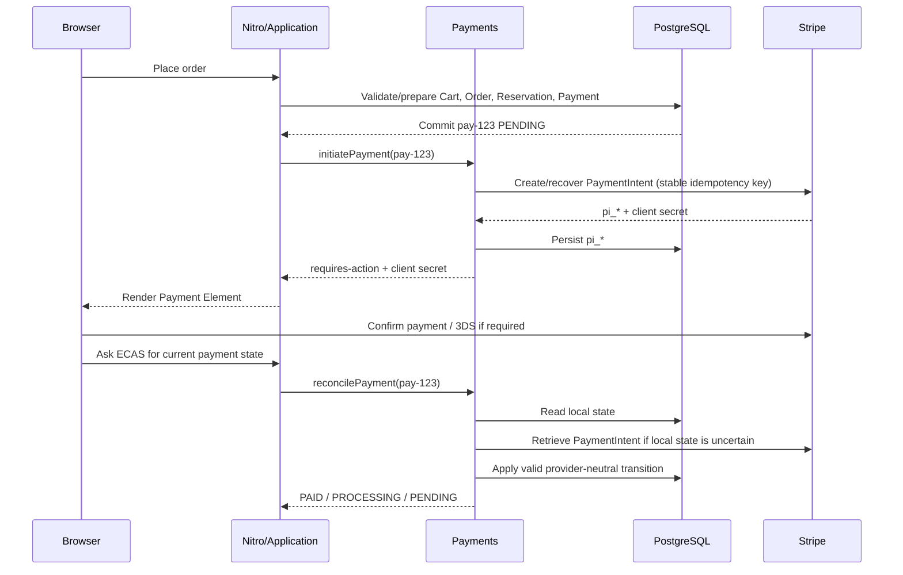

# System Design #8 — Stripe Payment Provider and Recovery Contract

Status: Ready for re-review  
Date: 2026-09-22  
Tracks: #121

## Purpose

System-design steps #6 and #7 established domain ownership, dependency direction,
durable checkout identity, commit-before-provider behavior, and provider-neutral
Payments seams. This document records the Stripe-specific decisions needed to
replace the current mock continuation without reopening those accepted
architecture decisions.

This is an ADR/design contract, not a live Stripe implementation.

The design intentionally stays proportional to agent-Commerce:

- one Nuxt/Nitro modular monolith;
- PostgreSQL as the durable checkout/payment store;
- Stripe as an external payment provider;
- no queues, brokers, microservices, distributed saga framework, or provider-attempt
  table until a demonstrated recovery requirement justifies them.

---

## 1. Context and current implementation seam

Current `server/domain/payments/index.ts` already provides:

- one durable local Payment per prepared Order;
- `preparePayment()` before provider continuation;
- `getPaymentPreparation()`;
- `continuePayment()` outside the retryable checkout transaction;
- local `PENDING / PAID / FAILED` state;
- a provider-neutral `PaymentNextAction` seam.

Current `placeOrder` persists the checkout claim, immutable Order, inventory
reservation, and local Payment before calling provider continuation.

That commit-before-provider boundary remains accepted.

The current gaps are provider-specific:

- `continuePayment()` still simulates success;
- `provider_reference` is ambiguous;
- real provider timeout/unknown-result reconciliation is absent;
- Stripe webhooks and signature verification are absent;
- recoverable card failure is not distinguished from terminal logical failure;
- refund persistence/reconciliation is absent;
- deployed Stripe sandbox behavior has not been validated.

---

## 2. Accepted provider choice

Use the Stripe **Payment Intents API + Payment Element** for the first real
provider integration.

Stripe recommends Checkout Sessions for most integrations because it manages more
checkout features for the application. agent-Commerce deliberately chooses the
lower-level Payment Intents API because this system already owns its checkout
state: Cart, pricing, Inventory, immutable Order creation, retry policy, and
recovery. Stripe's responsibility here is intentionally narrower: collect the
already-finalized Order amount safely.

This is a deliberate feature trade-off:

```text
agent-Commerce owns checkout/commercial state
            |
            v
one durable local Payment
            |
            v
one Stripe PaymentIntent
            |
            v
Payment Element / Stripe authentication
```

The design does not model Stripe Checkout Session expiry/replacement or provider
session generations in the first implementation.

agent-Commerce keeps control of:

- cart and checkout semantics;
- server-authoritative quote/order amount;
- inventory reservation and allocation;
- immutable Order history;
- local Payment identity and state;
- retry/recovery/finalization policy.

Stripe owns:

- secure payment-method collection;
- provider-side payment/authentication lifecycle;
- 3D Secure and other required customer authentication;
- provider-side payment/refund truth.

### First-slice payment-method scope

The first Stripe implementation supports **card payments only**, including cards
that require 3D Secure / additional authentication.

Do not enable redirect-based bank methods, delayed bank-transfer methods, or
other asynchronous payment-method families in the first slice. This keeps the
provider lifecycle narrow while the core PaymentIntent, webhook, reconciliation,
retry, and recovery guarantees are validated.

Payment Element remains the UI primitive, but its first implementation is
configured for the card-only scope.

The browser must never authoritatively decide that an Order is paid.

The amount and currency sent to Stripe come from the immutable persisted Order
snapshot, never from browser totals and never from a fresh Catalog reprice of an
existing Order.

References:

- https://docs.stripe.com/payments/payment-element
- https://docs.stripe.com/api/payment_intents

---

## 3. Dependency and adapter boundary

Target dependency direction:

```text
Nitro API / application workflow
            |
            v
      Payments public API
            |
            v
   Payments internal Stripe adapter
            |
            v
         Stripe SDK
```

Application workflows may depend on provider-neutral Payments commands/results.
They must not import Stripe SDK objects or raw Stripe status strings.

Stripe SDK types stay inside the Payments implementation boundary.

Allowed:

```ts
const result = await payments.initiatePayment({ paymentId });
```

Forbidden:

```ts
// application workflow
const intent = await stripe.paymentIntents.create(...);
```

A provider-specific webhook transport route is allowed, but it enters Payments
through the public module firewall rather than importing `payments/internal/*`
from a Nitro route.

---

## 4. Target Payments public contract

Keep the application-facing contract small and provider-neutral.

```ts
type PaymentStatus = 'PENDING' | 'PROCESSING' | 'PAID' | 'CANCELED';

type PaymentNextAction =
  Readonly<{ type: 'none' }> | Readonly<{ type: 'client-secret'; clientSecret: string }> | Readonly<{ type: 'redirect'; url: string }>;

type PaymentContinuationResult =
  | Readonly<{ kind: 'requires-action'; nextAction: PaymentNextAction }>
  | Readonly<{ kind: 'processing' }>
  | Readonly<{ kind: 'succeeded' }>
  | Readonly<{ kind: 'retryable-failure'; message?: string }>
  | Readonly<{ kind: 'terminal-failure'; message?: string }>
  | Readonly<{ kind: 'recovery-required'; message?: string }>;

type CancelPaymentResult =
  | Readonly<{ kind: 'canceled'; payment: PaymentView }>
  | Readonly<{ kind: 'paid'; payment: PaymentView }>
  | Readonly<{ kind: 'recovery-required'; payment: PaymentView; message?: string }>;

interface PaymentsService {
  preparePayment(input: PreparePaymentInput): Promise<PreparePaymentResult>;

  getPayment(paymentId: PaymentId): Promise<PaymentView | null>;

  initiatePayment(input: { paymentId: PaymentId }): Promise<PaymentContinuationResult>;

  cancelPayment(input: { paymentId: PaymentId; reason: PaymentCancellationReason }): Promise<CancelPaymentResult>;

  reconcilePayment(input: { paymentId: PaymentId }): Promise<PaymentReconciliationResult>;

  requestFullRefund(input: { paymentId: PaymentId; reason: RefundReason }): Promise<RefundResult>;
}
```

The exact TypeScript names may change during implementation, but these
responsibilities and boundary rules are fixed.

### Public-operation ownership

- `preparePayment()` creates or recovers the durable provider-agnostic local Payment only. It does not know about cards, Link, Payment Element, or Stripe PaymentIntent details.
- `getPayment()` reads the provider-neutral local Payment view; Stripe IDs remain internal Payments persistence details.
- `initiatePayment()` establishes or recovers the current usable provider payment flow. It is idempotent within Stripe's supported replay window and must never blindly invent replacement provider work after an unknown outcome.
- `reconcilePayment()` explicitly checks provider truth when local state may be stale or uncertain. It owns resulting local Payment transitions.
- `cancelPayment()` is called when the application determines the Order is permanently no longer payable. Payments coordinates cancellation with any in-flight/unknown PaymentIntent creation before committing a terminal local cancellation.
- `requestFullRefund()` is called when an application workflow has durably selected refund compensation; Payments owns creating/recovering/reconciling the Stripe refund and its durable local Refund state.
- `completePayment()`, `failPayment()`, and the old vague `continuePayment()` do not remain public application-facing commands in the Stripe contract.

A provider-neutral `recovery-required` result is allowed when ECAS cannot prove
provider identity safely enough to continue automatically. It is not a new
Payment status; the checkout claim remains recoverable/manual-intervention state
until provider truth is established.

The application layer decides cross-domain consequences, not provider truth. For example:

```text
paid recovery decision = REFUND
  -> Payments.requestFullRefund(...)
  -> Payments owns Stripe refund truth/state
```

### Provider-specific ingress

The Stripe webhook endpoint may expose one narrow Stripe-specific entry point
from the Payments module because the transport itself is provider-specific:

```ts
payments.handleStripeWebhook({
  rawBody,
  signature,
});
```

This does not permit Stripe SDK objects to leak into application workflows,
Orders, Inventory, Catalog, Cart, or Accounts.

---

## 5. Local Payment state model

Use four target local states:

| State        | Meaning                                                                                                                 |
| ------------ | ----------------------------------------------------------------------------------------------------------------------- |
| `PENDING`    | The logical Payment is still payable/retryable. It may already have a reusable Stripe PaymentIntent.                    |
| `PROCESSING` | Stripe is actively processing the payment or the provider outcome is temporarily uncertain after customer confirmation. |
| `PAID`       | Provider success has been confirmed locally.                                                                            |
| `CANCELED`   | The logical Payment is terminal because it can no longer collect money and the existing checkout must not be resumed.   |

Creating/recovering a Stripe PaymentIntent does **not** by itself move the local
Payment to `PROCESSING`. A PaymentIntent can exist while the customer has not
yet completed a payment attempt.

A normal card decline, invalid payment method, or other recoverable
payment-method failure returns/remains `PENDING`; it does not terminally fail
the logical Payment.

Stripe-specific statuses such as `requires_payment_method`,
`requires_confirmation`, and `requires_action` remain internal provider
details. They are translated into provider-neutral results / `PaymentNextAction`
instead of becoming additional ECAS database states.

### Valid transition table

| Current                  | Provider/local fact                                                                | Next                   | Notes                                                                                |
| ------------------------ | ---------------------------------------------------------------------------------- | ---------------------- | ------------------------------------------------------------------------------------ |
| `PENDING`                | PaymentIntent created/recovered; customer can still act                            | `PENDING`              | return client secret only after the final cancellation guard succeeds                |
| `PENDING`                | Stripe reports active processing or provider outcome is unknown after confirmation | `PROCESSING`           | provider work is genuinely in flight/uncertain                                       |
| `PROCESSING`             | recoverable payment-method failure                                                 | `PENDING`              | customer may retry the same logical Payment/PaymentIntent                            |
| `PENDING` / `PROCESSING` | definitive success                                                                 | `PAID`                 | monotonic success                                                                    |
| `PENDING`                | Order becomes permanently non-payable and no provider create ever started          | `CANCELED`             | safe local-only cancellation                                                         |
| `PENDING` / `PROCESSING` | cancellation requested after provider create started                               | reconcile/cancel first | do not commit `CANCELED` until provider collection is impossible                     |
| `PENDING` / `PROCESSING` | Stripe reports provider-initiated `canceled`                                       | `CANCELED`             | existing checkout becomes terminal; do not create a replacement intent on that claim |
| `PAID`                   | duplicate/stale failure/processing/cancellation signal                             | `PAID`                 | success must not regress                                                             |
| `CANCELED`               | stale non-success event                                                            | `CANCELED`             | terminal cancellation remains terminal                                               |

The implementation must enforce transitions conditionally in PostgreSQL rather
than reading a state and later assuming it is unchanged.

### Cancellation versus PaymentIntent creation

A null `stripe_payment_intent_id` does **not** prove that provider creation
never started. ECAS distinguishes:

```text
stripe_payment_intent_id = NULL
stripe_payment_intent_create_started_at = NULL
    -> provider creation never started

stripe_payment_intent_id = NULL
stripe_payment_intent_create_started_at != NULL
    -> provider creation was attempted; outcome may be unknown
```

`cancelPayment()` may immediately set local `CANCELED` only in the first case.

When creation has started, cancellation first durably records
`cancellation_requested_at`. If the PaymentIntent ID is known, Payments cancels
or reconciles that intent. If the ID is unknown, Payments recovers the same
create operation only while Stripe's idempotency replay is still safely usable.

`initiatePayment()` must perform a final conditional database check before
returning a client secret. If `cancellation_requested_at` was committed first,
the client secret is not returned. A recovered/created PaymentIntent is instead
persisted and canceled/reconciled.

A cancellation can still race **after** a client secret was legitimately returned
and the browser begins confirmation. If provider success wins that race, local
truth is `PAID`; the application then runs paid-order recovery and, when
necessary, compensating refund. Never force `PAID -> CANCELED`.

### Provider-initiated cancellation

Stripe can make a PaymentIntent terminal `canceled`, including after excessive
confirmation attempts. That is terminal for the existing checkout:

```text
Payment = CANCELED
  -> release any still-active reservation
  -> mark the existing checkout claim terminal
  -> do not recover/reopen that PaymentIntent
  -> customer returns to explicit order/cart review
```

If the customer chooses to try again, explicit re-review creates a **new Cart
revision** (the contents may be unchanged) and therefore a new checkout claim,
Order, Payment, and PaymentIntent. The canceled claim is never reused. This
preserves the accepted invariant of one logical checkout per customer/cart
revision.

---

## 6. Persistence decision

Keep provider persistence small but sufficient to distinguish "never started"
from "outcome unknown":

```text
checkout_payments
-----------------
id
order_id
status
amount_minor
currency
stripe_payment_intent_id                TEXT NULL
stripe_payment_intent_create_started_at TIMESTAMP NULL
cancellation_requested_at               TIMESTAMP NULL
...
```

The target model enforces:

```text
UNIQUE (order_id)
UNIQUE (stripe_payment_intent_id)   -- when non-NULL
```

The application may still perform lookup/recovery logic, but PostgreSQL is the
final concurrency-safe authority preventing two logical Payment rows from being
attached to the same Order.

Do not add Checkout Session identity, provider-session generations, or
provider-attempt rows. Do not persist a generic `provider` discriminator in the
first implementation.

The existing generic `provider_reference` is retired after compatibility
validation.

### Compatible rollout from the current mock Payment schema

The existing deployment has:

```text
status = PENDING | PAID | FAILED
use_existing_payment_method NOT NULL
```

and older deployed writers can still run the mock-era path where
`continuePayment()` simulates success and `completePayment()` can move a
matching `PENDING` Payment to `PAID`.

That creates **two distinct rollout gates**:

1. schema compatibility;
2. provider activation safety.

Schema expansion alone does not make Stripe safe to enable.

#### Phase A — compatible schema expansion

1. add nullable unique `stripe_payment_intent_id`;
2. add nullable `stripe_payment_intent_create_started_at` and
   `cancellation_requested_at`;
3. expand the database status constraint temporarily to accept both models:
   `PENDING / PROCESSING / PAID / FAILED / CANCELED`;
4. add a safe `DEFAULT FALSE` to `use_existing_payment_method` while keeping
   its existing `NOT NULL` constraint;
5. new code stops treating `payment_type`, `use_existing_payment_method`, and
   `provider_reference` as authoritative business data;
6. new code treats any legacy `FAILED` row as terminal and never reopens it.

During Phase A, **Stripe-backed payment creation remains disabled** on any
database that is still reachable by an older deployment capable of mock
completion.

A server-side provider activation gate (for example a deployment/environment
setting such as `PAYMENTS_PROVIDER=stripe`) stays off until the activation
preconditions below are proven. The exact flag name is an implementation detail;
the invariant is not.

#### Phase B — Stripe activation gate

Use the [Gate A activation runbook](../agents/payments/activation-gate-a-runbook.md)
to capture the deployment/database inventory, establish an isolated Preview
candidate, and record the cross-version replay evidence. The runbook is an
execution procedure; it does not approve activation or the later schema
contraction.

Before the first Stripe-backed PaymentIntent is created against a database:

1. enumerate every deployment/runtime that can write that checkout database;
2. upgrade, retire, or isolate every deployment that can still execute mock
   `continuePayment()/completePayment()`;
3. verify old Preview URLs either no longer write the shared database or point to
   an isolated database;
4. run a cross-version replay test proving an old deployment cannot mutate a
   Stripe-candidate Payment/Order to `PAID`;
5. only then enable the Stripe provider activation gate for that database.

This gate is stronger than SQL compatibility. It protects the payment-authority
invariant:

```text
only Stripe truth may make a Stripe-backed Payment PAID
```

No Stripe-backed Payment may coexist in a database with a reachable writer that
can fabricate payment success.

#### Phase C — controlled schema contract

Only after every writer using that database is upgraded, retired, or isolated:

1. backfill remaining `FAILED -> CANCELED`;
2. tighten the status constraint to
   `PENDING / PROCESSING / PAID / CANCELED`;
3. drop `payment_type`, `use_existing_payment_method`, and
   `provider_reference`;
4. verify no Preview deployment points an older writer at the contracted schema.

The provider activation gate (Phase B) may happen before the destructive schema
contract (Phase C), but never before unsafe mock writers are drained/isolated.

This remains a pragmatic expand -> activate -> contract rollout; it does not
introduce dual-write compatibility infrastructure.

---

---

## 7. Stripe PaymentIntent identity and bounded idempotency

Use one durable Stripe PaymentIntent for one logical local Payment / Order.

The initial PaymentIntent create uses a deterministic Stripe idempotency key
derived from the durable local Payment identity:

```text
payment:pay-123:intent
```

Before the provider call, ECAS conditionally persists
`stripe_payment_intent_create_started_at`. This durable timestamp is the
linearization marker that says provider creation may have started.

### Safe retry window

Stripe API v1 idempotency keys are not an eternal identity store. Stripe may
prune an idempotency result after at least 24 hours. Therefore:

```text
pi_* known
  -> retrieve/reuse that exact PaymentIntent

pi_* unknown + create_started_at < 24h ago
  -> retry the same create request with the same idempotency key

pi_* unknown + create_started_at >= 24h ago
  -> DO NOT automatically issue create again
  -> checkout claim becomes recovery_required
  -> return provider-neutral recovery-required
  -> require operational/manual reconciliation
```

The 24-hour cutoff is intentionally conservative. It prevents a late replay from
silently creating a second PaymentIntent after Stripe has pruned the original
idempotency result.

Manual recovery must first establish provider truth using Stripe/Dashboard
evidence and the stored non-sensitive correlation metadata. If the original
PaymentIntent is found, attach/reconcile it. Only if an operator can establish
that no provider PaymentIntent exists may a new explicit creation attempt be
authorized.

Attach non-sensitive correlation metadata where useful:

```text
paymentId = pay-123
orderId   = ord-456
```

Do not store card data, customer secrets, addresses, or other sensitive values
in Stripe metadata merely for convenience.

The same bounded-idempotency principle applies to Refund creation in section 14.

References:

- https://docs.stripe.com/api/idempotent_requests
- https://docs.stripe.com/api/payment_intents

---

## 8. Normal payment sequence



Browser completion/return is not authoritative payment truth.

### Client-side payment confirmation

The first implementation uses Stripe's Payment Element in the browser to confirm
the PaymentIntent.

```text
Nitro / Payments
  -> create or recover PaymentIntent
  -> return client secret

Browser
  -> render Payment Element
  -> user submits payment
  -> Stripe.js confirms the PaymentIntent
  -> Stripe handles card data and required authentication
```

Card/payment-method details do not pass through the Nitro API.

The browser may display immediate provider UI results, but it must not mark the
Order or local Payment as paid. After confirmation/return, the browser asks ECAS
for current state; Payments reconciliation and/or the Stripe webhook establish
provider truth, and the application workflow performs cross-domain finalization.

Do not add an ECAS state-changing request merely because the buyer clicked
`Pay`. The browser may immediately show a local "Processing payment…" UI, but
the persisted Payment remains `PENDING` until Stripe truth observed through
reconciliation/webhook justifies `PROCESSING`, `PAID`, or a return to
`PENDING`.

Do not add a server-side PaymentIntent confirmation endpoint in the first slice
unless a demonstrated payment method or provider requirement needs one.

---

## 9. Timeout / lost-response recovery sequence

```mermaid
sequenceDiagram
    participant A as Application
    participant P as Payments
    participant DB as PostgreSQL
    participant S as Stripe

    A->>P: initiatePayment(pay-123)
    P->>DB: Persist create_started_at if still PENDING and not cancel-requested
    P->>S: Create PaymentIntent, key payment:pay-123:intent
    S--xP: Response lost / timeout
    Note over DB: pay-123 durable; pi_* may still be NULL
    A->>P: retry initiatePayment(pay-123)
    P->>DB: Read pi_* / create_started_at / cancellation_requested_at
    alt within safe idempotency window
        P->>S: Retry same create operation with same key
        S-->>P: Same PaymentIntent result
        P->>DB: Persist pi_*
    else replay window no longer safe
        P-->>A: recovery-required; no new create
    end
```

Provider timeout is never converted directly to local `CANCELED` or to a new
logical Payment.

A timeout plus `NULL stripe_payment_intent_id` is explicitly **unknown
provider outcome**, not proof that Stripe has no PaymentIntent.

---

## 10. Browser refresh, 3DS, and reconciliation

The browser asks ECAS for payment/checkout status after refresh, return from
authentication, or uncertain UI state.

Recovery order:

```text
Browser
  -> ECAS backend
       -> PostgreSQL first
       -> Stripe only when local provider state is uncertain
       -> apply valid local Payment transition inside Payments
       -> application workflow retries local finalization if PAID
```

`reconcilePayment()` performs one bounded provider reconciliation request. It
waits a reasonable amount of time for the Stripe API call itself to answer, but
it does not loop internally waiting for Stripe's payment state to stop being
`processing`.

If Stripe still reports processing:

```text
Payments.reconcilePayment()
  -> return PROCESSING
  -> browser may retry ECAS reconciliation for a limited period
  -> Stripe webhook remains an independent completion path
```

The UI may poll ECAS briefly for a smoother experience, but must stop aggressive
polling after a bounded period and continue showing a safe processing/finalizing
state. A long-running provider payment must not hold a Vercel request open.

The frontend must not treat a Stripe redirect, Payment Element callback, or URL
parameter as authoritative settlement.

A useful intermediate customer state is:

```text
Payment received — finishing your order
```

3D Secure and other additional authentication remain Stripe UI/provider
concerns. They do not create an ECAS `REQUIRES_3DS` persistence state.

Payments owns interpreting Stripe truth and moving the local Payment to
`PAID`; Payments does **not** finalize Inventory, Orders, or Cart. Once the
application workflow observes `PAID`, it owns retry-safe cross-domain
finalization.

---

## 11. Webhook contract

Provider route:

```text
POST /api/payments/stripe/webhook
```

Required behavior:

1. Read the raw request body required for Stripe signature verification.
2. Verify the Stripe signature before trusting the event.
3. Correlate the event to the local Payment using persisted Stripe IDs and/or
   non-sensitive ECAS metadata.
4. If the provider event is ambiguous or stale, reconcile current Stripe state
   instead of trusting arrival order.
5. Record the Stripe event ID and its corresponding local Payment transition in
   the same short PostgreSQL transaction.
6. For payment success, run the retry-safe application completion path after
   that transaction and before acknowledging success.
7. For fulfillment branches, return `2xx` only after critical Inventory/Order/
   claim finalization is already complete or has just completed successfully.
8. For the `REFUND` branch, return `2xx` only after compensation state is
   durable **and** a Stripe Refund ID is durably known (or Refund success is
   already durable). Settlement may continue asynchronously afterward.
9. If the applicable fulfillment/compensation acknowledgment gate is not met,
   return non-`2xx` so Stripe retries delivery.
10. On duplicate delivery, deduplicate the provider Payment transition but still
    inspect/retry unfinished fulfillment or compensation work.

"Duplicate event is a no-op" applies only to the already-committed provider
transition. It does **not** mean the whole webhook request becomes a no-op.

### Atomic provider-transition invariant

For the provider truth step:

```text
Stripe event ID recorded
        <=>
corresponding local Payment transition committed
```

Conceptual first transaction:

```sql
BEGIN;

INSERT INTO stripe_webhook_events (event_id, event_type, payment_id, created_at)
VALUES (...);

UPDATE checkout_payments
SET status = ...
WHERE id = ...
  AND status IN (...);

COMMIT;
```

Do not hold that transaction open during slow Stripe calls or cross-domain
finalization.

### Success acknowledgment sequence

```text
payment_intent.succeeded
  -> verify + reconcile if needed
  -> short transaction:
       event ID + Payment=PAID
  -> application.finalizePaidCheckout(payment/order/claim)
       -> normal active reservation?
            -> Inventory commit
            -> Order paid
            -> claim finalized
       -> expired reservation?
            -> durable recovery decision:
                 ALLOCATE / BACKORDER / REFUND
  -> acknowledgment gate reached?
       yes -> 2xx
       no  -> non-2xx
```

For `ALLOCATE` and `BACKORDER`, the existing critical finalization rule
applies: the Order/Inventory/claim decision must be durably complete before
`2xx`.

For `REFUND`, fulfillment is forbidden. The success webhook uses a distinct
**compensation completion gate**:

```text
paid_recovery_decision = REFUND
  -> Order lifecycle = ON_HOLD
  -> claim workflow = compensation_pending
  -> durable Refund row exists
  -> Payments.requestFullRefund()
  -> stripe_refund_id durably known?
       yes -> original payment success webhook may return 2xx
       no  -> return non-2xx so duplicate delivery resumes compensation
```

The original success webhook does **not** wait for the refund to settle
`SUCCEEDED`. Once a durable Stripe Refund ID is known, refund webhooks and
explicit refund reconciliation provide an independent continuation path.

If the process crashes after committing `REFUND` but before creating/recovering
the provider Refund, duplicate delivery follows the already-committed decision
and calls `requestFullRefund()` again. It must never fall back to Inventory
allocation.

If the Refund is `PENDING` with a known Stripe ID, fulfillment remains blocked
and the original success webhook can acknowledge because provider refund identity
is durable. If the Refund becomes `FAILED`, or its creation outcome remains
unknown without a safe provider ID, the Order stays `ON_HOLD`, the claim stays
in compensation recovery, and fulfillment remains permanently prohibited until
refund recovery is explicitly resolved.

Best-effort revision-aware Cart cleanup is **not** required before webhook
acknowledgment.

This first slice intentionally keeps critical finalization bounded and local to
the PostgreSQL-backed modular monolith. If it later cannot complete within a
reasonable webhook request budget, that would be concrete evidence for a
durable background/outbox mechanism; no queue is added preemptively.

### Initial event scope

| Stripe event                    | Initial ECAS behavior                                                                                  | Implementation owner |
| ------------------------------- | ------------------------------------------------------------------------------------------------------ | -------------------- |
| `payment_intent.succeeded`      | Transition/reconcile `PAID`, then retry critical application finalization before `2xx`.                | #557                 |
| `payment_intent.processing`     | Reconcile and keep/move local Payment to `PROCESSING` when provider work is genuinely in flight.       | #557                 |
| `payment_intent.payment_failed` | Reconcile; return/remain retryable `PENDING` when appropriate.                                         | #557                 |
| `payment_intent.canceled`       | Reconcile terminal provider cancellation; release active reservation and terminalize the old checkout. | #557                 |
| `refund.created`                | Correlate/reconcile durable Refund.                                                                    | #558                 |
| `refund.updated`                | Reconcile Refund to current provider truth.                                                            | #558                 |
| `refund.failed`                 | Reconcile definitive Refund failure.                                                                   | #558                 |

Webhook arrival order is never the source of truth.

Reference:

- https://docs.stripe.com/webhooks

---

## 12. Paid finalization and late-success recovery

Payment truth and fulfillment truth remain separate.

Normal success:

```text
Payment PAID
  -> Inventory.commit(existing reservation)
  -> Orders.confirmPayment / markPaid
  -> checkout claim finalized
  -> revision-aware Cart cleanup (best effort)
```

All critical local finalization transitions must remain retry-safe. The webhook
success path retries this workflow when a previous invocation crashed after
Payment became `PAID`.

### Paid after reservation expiry

An expired reservation cannot be resurrected. When a paid order reaches this
path, concurrent recovery calls must not be allowed to choose conflicting
outcomes such as "fulfill" and "refund".

Persist one nullable application-owned decision on the checkout claim:

```text
paid_recovery_decision =
  ALLOCATE
  BACKORDER
  REFUND
```

The application workflow selects this decision once under PostgreSQL
coordination.

The portfolio-demo policy for #585 was explicitly approved by the user on
2026-10-09: allocate all frozen Order quantities if Inventory can provide them;
otherwise backorder the shortage only when the frozen buyer shipping choice
permits it; otherwise select a full refund. Inventory currently permits the
existing active demo choice `back-001` for active sample products. Missing or
unknown choices and unsupported products deny backorder permission. Availability
is `on_hand - reserved`, after expiring the old reservation; another checkout's
reservations are never available to this recovery. This is the approved demo
policy, not a configurable production policy.

`recoverLatePaidCheckout({ paymentId, orderId })` returns either `retry` or the
existing/new `decided` outcome. It reads validated frozen quantities and choice
through Orders, and delegates stock locks, eligibility and the replacement
reservation to Inventory. It never revives an expired reservation. For
ALLOCATE/BACKORDER it commits a new reservation, the paid Order marker, separate
`fulfillment` buckets and the finalized claim in one PostgreSQL transaction.
Accepted Order products, buyer choice and money stay unchanged; each fulfillment
item preserves the accepted total quantity. Refund uses the existing coordinated
held-Order command. Concurrent callers lock the same claim and cannot switch a
committed decision. Provider continuation belongs to #588 and happens after
commit; revision-aware Cart cleanup can use the existing finalization replay.

For `ALLOCATE`, the Inventory allocation and durable decision are committed as
one coordinated database unit so a later recovery cannot switch to refund.

For `BACKORDER`, the backorder/Order state and decision are durably committed
before returning.

For `REFUND`, fulfillment is permanently prohibited once the decision commits.
Commit the following local compensation state **before** any Stripe refund call:

```text
Payment = PAID
Order lifecycle = ON_HOLD
checkout claim workflow_status = compensation_pending
paid_recovery_decision = REFUND
```

The immutable Order/payment history remains paid; `ON_HOLD` means commercial
fulfillment is blocked while compensation is being recovered.

Then create/recover one durable Refund:

```text
compensation_pending
  -> requestFullRefund()
       -> provider refund identity known
            -> keep compensation_pending until provider settlement
       -> refund SUCCEEDED
            -> Order lifecycle = CANCELED
            -> claim workflow_status = finalized
       -> refund FAILED / unsafe unknown outcome
            -> claim workflow_status = compensation_recovery_required
            -> Order remains ON_HOLD
            -> never allocate/backorder
```

`compensation_recovery_required` is application workflow state, not a Payment
status. It keeps the Order visibly non-fulfillable while an operator or explicit
reconciliation resolves refund truth.

Duplicate `payment_intent.succeeded` delivery after `REFUND` commits resumes
the **same** compensation path. It must not re-run the allocation decision.

A successful Payment must never be rewritten to `CANCELED` because fulfillment
later became impossible. The Order may become lifecycle `CANCELED` after a
successful refund while Payment remains `PAID`.

---

## 13. Payment retry, resume, and terminal re-review

Retry is user initiated; ECAS does not automatically re-charge.

The cross-domain recovery operation is an **application workflow**:

```text
resumeOrderPayment
  -> Orders: existing Order still payable?
  -> Inventory: reservation valid?
       yes -> continue
       no  -> Inventory re-establishes reservation if policy/stock permits
  -> Payments: initiate/recover the existing PaymentIntent
  -> return provider-neutral payment action
```

Orders owns payability, Inventory owns reservation renewal, Payments owns provider
truth. Payments must not inspect Inventory or decide Order payability.

### Returning to an unfinished payment

Keep the payment view visible but disabled while `resumeOrderPayment` runs:

```text
We're checking that your order is still available…
```

Only after the workflow returns a safe payable result/client secret may the UI
enable Stripe Payment Element confirmation.

If commercial facts remain unchanged and Inventory can safely continue, reuse the
same immutable Order, local Payment, and PaymentIntent.

If the Order is no longer payable, cancel/reconcile the Payment and keep the
checkout context visible with a route back to review.

### Provider-canceled PaymentIntent

If Stripe has terminally canceled the PaymentIntent, the existing checkout is not
resumable.

```text
payment_intent.canceled
  -> Payment = CANCELED
  -> release active reservation
  -> terminalize old checkout claim
  -> UI: "Review order and try again"
  -> explicit re-review mints a new Cart revision
  -> new PlaceOrder creates new claim + Order + Payment + PaymentIntent
```

The old claim is not recovered and does not receive a replacement PaymentIntent.
The new Cart revision preserves the one-logical-checkout-per-cart-revision
invariant even when item contents did not change.

Reference:

- https://docs.stripe.com/api/payment_intents/confirm

---

## 14. Refund contract

Refund is a separate durable financial fact. A successfully collected Payment
remains `PAID` even if a refund later succeeds.

Initial durable Refund model:

```ts
type RefundStatus = 'PENDING' | 'SUCCEEDED' | 'FAILED';

type PaymentRefund = Readonly<{
  refundId: string;
  paymentId: PaymentId;
  amountMinor: number;
  currency: string;
  status: RefundStatus;
  stripeRefundId: string | null;
  stripeRefundCreateStartedAt: string | null;
  reason: RefundReason;
  createdAt: string;
  updatedAt: string;
}>;
```

First implementation supports full refunds only and enforces:

```text
UNIQUE (payment_id)
UNIQUE (stripe_refund_id)   -- when non-NULL
```

The application may call `requestFullRefund()` only after the durable paid
recovery decision is `REFUND` and the claim has entered
`compensation_pending`.

Before the first Stripe create call, persist
`stripe_refund_create_started_at`. Refund creation then follows the same bounded
idempotency rule as PaymentIntent creation:

```text
stripe_refund_id known
  -> reconcile that Refund

ID unknown + create_started_at < 24h
  -> retry same Stripe create with same deterministic key

ID unknown + create_started_at >= 24h
  -> do not create again automatically
  -> Refund remains PENDING
  -> claim = compensation_recovery_required
  -> Order remains ON_HOLD
  -> surface operational/manual recovery required
```

### Original payment-success webhook and refund continuation

The original `payment_intent.succeeded` webhook may acknowledge the REFUND
branch only after a Stripe Refund ID is durably attached to the local Refund (or
the Refund has already reached `SUCCEEDED`).

Before that point, failures/crashes return non-`2xx` so Stripe duplicate
delivery re-enters the same compensation workflow.

Once `stripe_refund_id` is known:

- `PENDING`: original payment-success webhook may return `2xx`; refund
  webhook/reconciliation owns completion.
- `SUCCEEDED`: move Order lifecycle to `CANCELED`, finalize the claim, and
  keep Payment `PAID`.
- `FAILED`: move claim to `compensation_recovery_required`; keep Order
  `ON_HOLD`; do not fulfill. Operator/explicit reconciliation may repair/retry
  only under the same one-Refund-per-Payment safety rules.
- provider outcome unknown with no durable Refund ID: do not acknowledge the
  payment-success webhook as complete; duplicate delivery keeps retrying until a
  safe provider identity or manual recovery decision is established.

Refund webhook events (`refund.created`, `refund.updated`, `refund.failed`)
belong to the refund slice (#558), not the generic payment webhook slice.

Partial refunds, arbitrary customer-service refund UI, and multi-refund
allocation remain out of scope.

---

## 15. Failure-oriented validation matrix

| Failure                                                            | Required behavior                                                                                                                                         |
| ------------------------------------------------------------------ | --------------------------------------------------------------------------------------------------------------------------------------------------------- |
| Browser retries PlaceOrder                                         | Existing checkout claim / Payment is recovered; no duplicate Order/Payment.                                                                               |
| Old mock deployment shares DB before Stripe activation             | Stripe activation remains disabled until that writer is upgraded/retired/isolated.                                                                        |
| Cross-version replay targets a Stripe-candidate checkout           | Old deployment cannot mutate the shared Stripe Payment/Order to `PAID`.                                                                                   |
| PaymentIntent create request times out (<24h)                      | Retry the same create operation with the same key; recover the same intent.                                                                               |
| PaymentIntent ID remains unknown beyond safe idempotency window    | Do not create automatically; mark checkout recovery-required and require operational reconciliation.                                                      |
| Cancellation races PaymentIntent creation                          | `cancellation_requested_at` prevents a client secret from being returned after cancellation wins; recover/cancel provider object if creation had started. |
| Stripe succeeds after cancellation races                           | `PAID` wins; application follows durable paid-recovery decision and may refund.                                                                           |
| Stripe provider-cancels PaymentIntent                              | Existing claim becomes terminal; explicit re-review creates a new Cart revision and new checkout.                                                         |
| Browser refreshes during 3DS                                       | Browser asks ECAS; ECAS reads PostgreSQL then reconciles Stripe if required.                                                                              |
| Duplicate non-success webhook                                      | Provider transition is deduplicated safely.                                                                                                               |
| Success webhook crashes after Payment=PAID but before finalization | Return non-2xx; Stripe retry sees duplicate event ID but retries unfinished application finalization.                                                     |
| REFUND decision commits, then process crashes before Refund create | Return non-2xx; duplicate success webhook resumes `requestFullRefund()`; fulfillment is forbidden.                                                        |
| Refund ID known but Refund still PENDING                           | Original success webhook may acknowledge; refund webhook/reconciliation continues independently.                                                          |
| Refund FAILED                                                      | Order stays ON_HOLD, claim becomes compensation_recovery_required, fulfillment remains blocked.                                                           |
| Refund provider outcome unknown with no safe ID                    | No blind second refund and no fulfillment; payment-success webhook remains unacknowledged until safe identity/manual recovery.                            |
| Success webhook response is lost after finalization                | Duplicate retry observes finalized checkout and returns 2xx without repeating side effects.                                                               |
| Out-of-order failure after success                                 | Local `PAID` does not regress.                                                                                                                            |
| Webhook provider-transition DB transaction crashes                 | Event ID and Payment transition both roll back; retry remains safe.                                                                                       |
| Concurrent late-paid recovery sees stock/refund possibilities      | One durable `paid_recovery_decision` wins; fulfillment and refund are mutually exclusive.                                                                 |
| Refund create outcome unknown (<24h)                               | Retry same logical Refund/create key.                                                                                                                     |
| Refund ID unknown beyond safe idempotency window                   | No blind second refund; claim stays compensation_recovery_required and Order stays ON_HOLD.                                                               |
| Newer Cart revision exists after payment                           | Finalized purchase remains true; cleanup must not destroy the newer Cart.                                                                                 |

---

## 16. Testing and deployment evidence

Use three practical validation levels.

### Level 1 — CI / deterministic integration

Use the mock provider with real PostgreSQL semantics to test:

- local Payment state transitions;
- compatible Phase-A migration with legacy `FAILED` writers;
- `use_existing_payment_method` default compatibility;
- Stripe activation gate remains disabled while an unsafe mock writer is present;
- cross-version replay harness proves old mock completion cannot touch Stripe-
  candidate rows after activation prerequisites are satisfied;
- checkout/payment idempotency;
- PaymentIntent unknown-result recovery inside and beyond the safe replay window;
- cancellation-versus-create races, including "cancellation wins before client secret";
- duplicate/out-of-order event handling;
- crash after `Payment=PAID` commit but before finalization, with **no browser return**;
- crash immediately after `paid_recovery_decision=REFUND` commits, with **no browser return**;
- duplicate success webhook resumes Refund creation rather than fulfillment;
- PostgreSQL concurrency/conditional transitions;
- mutually exclusive late-success `ALLOCATE / BACKORDER / REFUND` decisions;
- refund timeout/retry and idempotency-window expiry.

### Level 2 — local Stripe sandbox

Use a Stripe sandbox with the real Stripe SDK, Payment Element, and Stripe CLI
webhook forwarding to exercise:

- successful card payment;
- recoverable decline;
- 3D Secure/additional authentication;
- provider timeout/retry behavior where practical;
- provider-canceled PaymentIntent behavior;
- webhook signature verification;
- duplicate success event replay after forced local finalization failure;
- duplicate success event replay after forced crash immediately after the REFUND
  decision;
- full refund and refund reconciliation.

### Level 3 — Vercel Preview + Stripe sandbox

Validate the deployed browser/server/runtime boundary:

- enumerate every deployment that can write the shared checkout database;
- prove old mock-completion deployments are upgraded, retired, or isolated
  **before enabling Stripe-backed payment creation**;
- run a cross-version replay smoke proving an old Preview URL cannot mark a
  Stripe-backed Payment/Order paid;
- only then enable the server-side Stripe provider activation gate;
- real PaymentIntent creation/recovery from a Preview deployment;
- Payment Element rendering and return flow;
- HTTPS webhook delivery/signature verification;
- payment success -> retry-safe local finalization;
- REFUND decision -> durable Refund identity -> safe webhook acknowledgment;
- refresh/resume recovery before enabling Stripe UI;
- independent serverless invocation behavior;
- full-refund recovery path where practical.

Phase-C schema contraction is a later gate: only after every writer against that
database is upgraded, retired, or isolated do we remove legacy `FAILED` and
drop legacy columns.

Production real-money rollout remains out of scope.

---

## 17. Explicit non-goals

Do not add in the first Stripe implementation:

- app-owned saved-card/customer wallet;
- separate provider-attempt persistence;
- manual authorization/capture;
- partial refunds;
- background queues/brokers;
- microservices;
- distributed saga framework;
- direct Stripe SDK usage in application workflows or other domains;
- repricing an existing Order during payment retry.

Stripe Link/provider-managed saved methods can be evaluated later without making
the application own card credentials.

---

## 18. Implementation ownership after ADR acceptance

Implementation order follows backend dependencies rather than UI order. The
original slices below describe capability scope. Since 2026-10-02, #557 and
#558 are tracking epics with fixed executable children, not agent work items.
The capability graph at the end of this section supersedes their original issue
ordering; merged foundations are complete and are not reimplemented.

### Slice A / #554 — compatible Payment persistence expansion

- add `stripe_payment_intent_id`,
  `stripe_payment_intent_create_started_at`, and
  `cancellation_requested_at`;
- temporarily allow legacy `FAILED` plus new `PROCESSING/CANCELED` states;
- add safe default for legacy `use_existing_payment_method NOT NULL`;
- keep old writers schema-compatible;
- keep Stripe provider activation **off** while any writer sharing the DB can
  still perform mock payment completion;
- add the activation precondition to the implementation contract.

### Slice B / #555 — PaymentIntent adapter + creation/cancellation coordination

- Stripe SDK isolated inside Payments;
- one PaymentIntent per logical local Payment / Order;
- deterministic Payment-derived Stripe idempotency key;
- durable create-start timing;
- bounded (<24h) automatic replay policy;
- recovery-required/manual policy beyond the replay window;
- cancellation-request coordination so cancellation can win before client-secret release.

### Slice C / #557 — webhook, reconciliation, and backend recovery workflows

- Stripe signature verification;
- durable event-ID dedup + same-transaction provider transition;
- duplicate success delivery retries unfinished finalization;
- success `2xx` only after critical fulfillment finalization **or** the REFUND
  branch has a durable provider Refund identity;
- `reconcilePayment()`;
- application-owned `resumeOrderPayment()` with Inventory-owned reservation renewal;
- provider-canceled PaymentIntent terminalization + explicit new-revision checkout restart;
- compensation claim states (`compensation_pending` /
  `compensation_recovery_required`) and Order `ON_HOLD` semantics are defined
  here, while refund provider operations/events are owned by #558.

### Slice D / #556 — Payment Element card + 3DS UI

- Payment Element in the ECAS checkout modal/page;
- card-only + 3DS;
- Payment Element disabled until `resumeOrderPayment()` returns a safe payable result;
- provider-neutral processing/finalizing/recovery-required UX;
- provider-canceled flow routes to explicit re-review/new checkout;
- no app-owned saved-card implementation.

### Slice E / #558 — late success + full refund recovery

- transactional `paid_recovery_decision` and expired-reservation branch
  selection are owned by #585 under #557; the commercial selection rule must
  be recorded before pickup;
- durable compensation continuation after `REFUND` commits;
- durable full Refund entity;
- refund create-start timing and bounded idempotency;
- refund webhook/reconciliation ownership;
- duplicate payment-success delivery resumes refund creation until durable
  `stripe_refund_id` exists.

### Slice F / #559 — Stripe activation + sandbox deployment validation + contract gate

- deterministic CI/mock + PostgreSQL coverage;
- local Stripe sandbox/CLI evidence;
- enumerate/retire/upgrade/isolate unsafe mock writers;
- cross-version replay proving old deployments cannot fabricate `PAID` on a
  Stripe-backed checkout;
- only then enable Stripe provider creation against the shared DB;
- Vercel Preview + Stripe sandbox smoke;
- later verify all old writers are gone before Phase-C status/legacy-column
  contraction;
- document remaining production-only risks.

Remaining executable capabilities:

```text
merged #554/#555 and #557 foundations
  -> #584 owner-scoped provider refresh/return recovery
  -> #585 one durable paid-recovery outcome (policy decision required)
  -> #586 durable full provider Refund
       -> #587 Refund event reconciliation/settlement
#585 + #586 + #587 -> #588 late-paid webhook continuation
#584 + #588 -> #556 Payment Element/3DS UI
#556 + #588 + #586 + #587 -> #559 activation Gate A

#557 tracks #584/#585/#588
#558 tracks #586/#587
```

#583 separately tracks existing payment state/public error contract cleanup.
#559 requires the UI and named refund/backend recovery capabilities and contains
the **Stripe activation gate** as well as the later schema-contract gate. The
tracking epics close after their fixed children and integration evidence pass.

---

## 19. Consequences and trade-offs

### Benefits

- preserves the accepted modular-monolith dependency direction;
- keeps Stripe replaceable at the Payments boundary without prematurely building
  a generic multi-provider framework;
- preserves durable local identity before provider I/O;
- handles the highest-risk failure cases: timeout, duplicate events, stale events,
  browser refresh, and late success;
- keeps the first implementation understandable and reviewable.

### Accepted limitations

- one logical local Payment intentionally maps to one reusable Stripe PaymentIntent; intentionally replacing it with multiple provider PaymentIntents is out of scope for the first slice;
- only full refunds are supported;
- no application-owned saved-card wallet;
- no proactive/background recovery if the customer never returns and no webhook
  arrives; add recovery infrastructure only if real evidence requires it.

These limitations are deliberate scope choices, not accidental omissions.

---

## 20. Relationship to earlier design documents

This ADR refines, but does not replace:

- `06-domain-boundaries-and-ownership.md`;
- `07-public-module-contracts-and-dependency-graph.md`.

Where those documents describe the earlier preparation-only
`PENDING / PAID / FAILED` model or neutral `providerReference`, this ADR is the
accepted provider-specific refinement for the Stripe implementation slice.

The invariant that remains unchanged is:

```text
durable local Payment first
        ->
provider I/O second
        ->
retry/reconcile using the same logical identities
```
